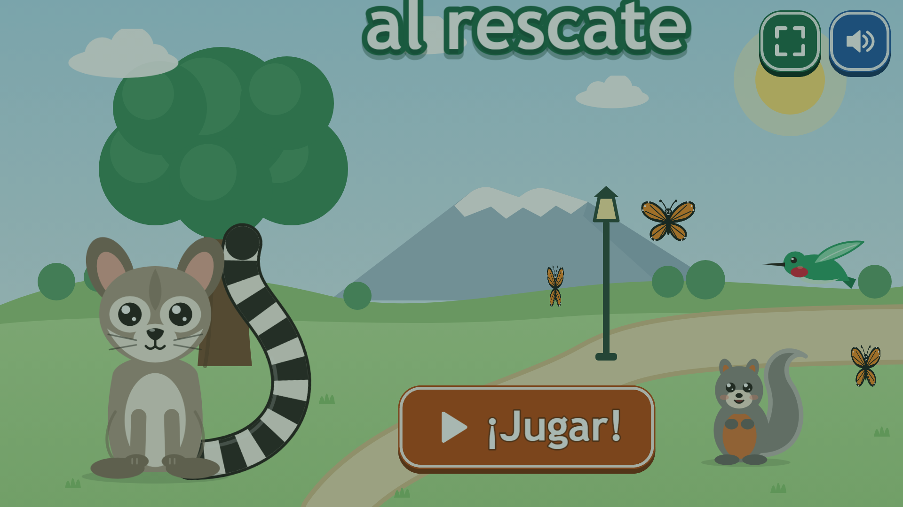
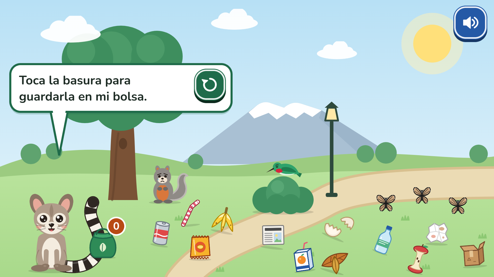
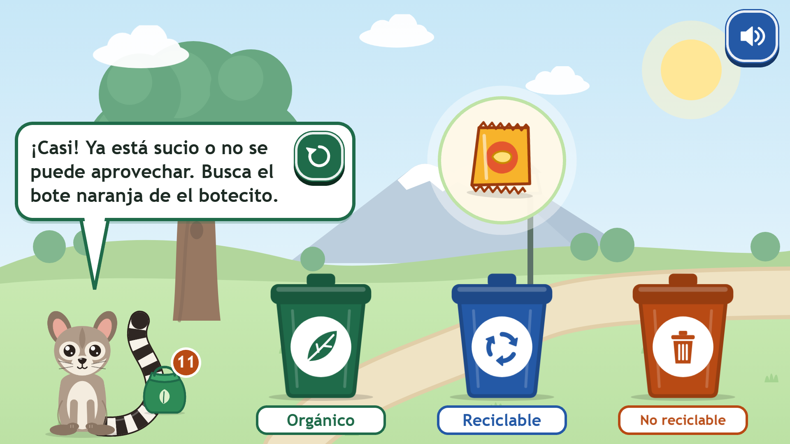
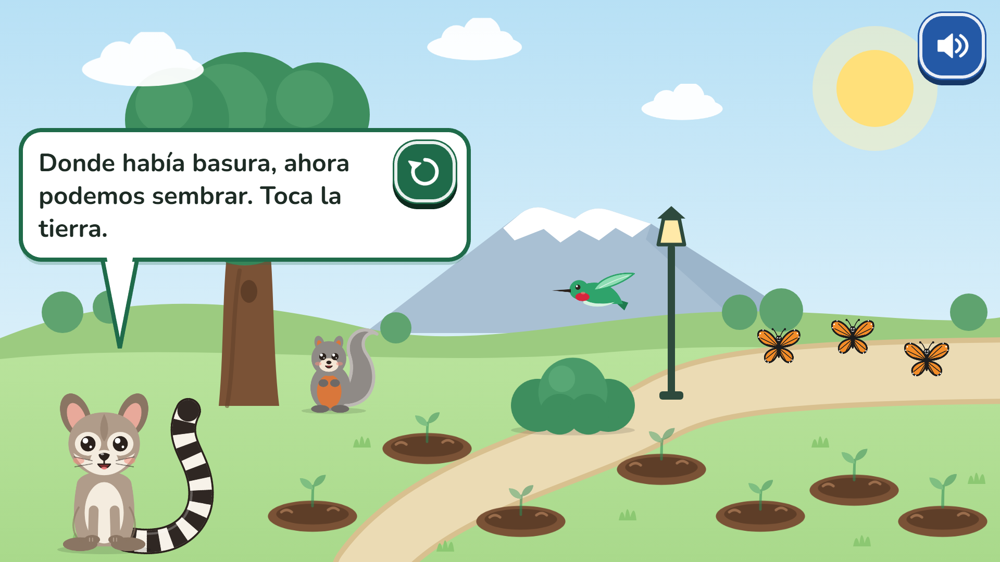
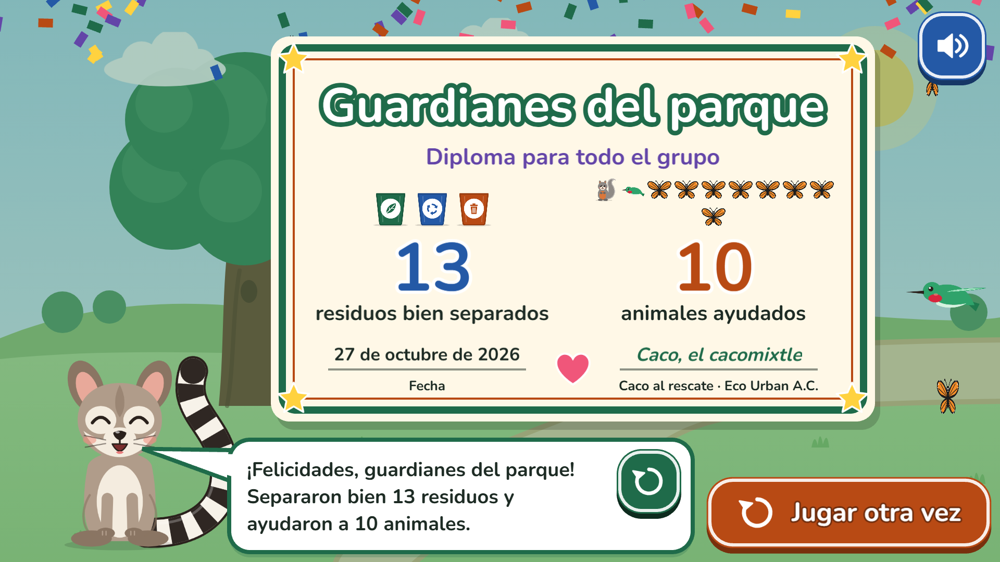

# Caco al rescate

Prototipo jugable de un videojuego educativo para **Eco Urban A.C.** (Toluca, Estado de México), pensado para el programa *Escuelas Comprometidas con el Medio Ambiente*.

Caco, un cacomixtle que vive en los árboles del parque, guía al grupo para **cuidar a los animales del parque y aprender a separar la basura**: la basura mal tirada lastima a la ardilla, al colibrí y a las mariposas monarca.

- **Para quién:** niñas y niños de 1º a 3º de primaria (6 a 8 años). Todo se narra en voz alta; el texto acompaña, pero no hace falta saber leer.
- **Dónde:** en la laptop de Eco Urban proyectada en el salón (todo el grupo participa) o en tablets táctiles.
- **Qué es:** un prototipo para revisar, jugar y aprobar. No es un producto final. No tiene servidor, cuentas ni analítica.



## Cómo se juega

1. **Inicio:** botón grande "¡Jugar!" y botón de sonido.
2. **Intro:** Caco se presenta en tres frases cortas; se avanza tocando la pantalla.
3. **Nivel 1, limpia el parque:** se toca la basura y vuela a la bolsa de Caco. Cuando una zona queda limpia, su animal se pone feliz.
4. **Nivel 2, ¿a qué bote va?:** cada residuo se arrastra (o se toca el bote) al bote correcto. Si acierta, hay celebración y un dato curioso; si no, el residuo regresa y Caco da una pista amable. No hay castigo ni vidas.
5. **Nivel 3, un hogar para los animales:** se siembran árboles y flores donde había basura; llegan las mariposas monarca a las flores y el colibrí al árbol.
6. **Bonus, "Muéstrale a Caco":** se muestra una basura real a la cámara y Caco intenta reconocerla. Es opcional: sin cámara se juega con dibujos.
7. **Diploma "Guardianes del parque"** para el grupo, con cuántos residuos separaron bien y cuántos animales ayudaron.

| Nivel 1 | Nivel 2 (pista amable) |
|---|---|
|  |  |
| **Nivel 3** | **Diploma** |
|  |  |

Las capturas de todas las pantallas a 1920×1080 y 1024×768 están en [`docs/capturas/`](docs/capturas/). Las genera la prueba de recorrido (ver *Pruebas*).

## Correrlo en Windows

Requisitos: [Node.js](https://nodejs.org) 22.12 o más nuevo (la versión LTS sirve) y Chrome o Edge.

```powershell
npm install
npm run dev
```

Abre <http://localhost:5173> en Chrome o Edge. Para proyectar, pon el navegador en pantalla completa (F11).

Todos los comandos son scripts de npm; ninguno necesita bash. Funcionan en PowerShell o en el símbolo del sistema.

| Comando | Qué hace |
|---|---|
| `npm run dev` | Juego en modo desarrollo, con recarga automática |
| `npm run build` | Revisa tipos y genera el sitio estático en `dist/` |
| `npm run preview` | Sirve `dist/` para probar la versión final |
| `npm test` | Pruebas unitarias (Vitest) |
| `npm run test:e2e` | Recorridos completos en el navegador (Playwright) |
| `npm run verificar` | Tipos + lint + pruebas + build, todo junto |

> **Cámara en tablets:** los navegadores solo permiten la cámara en `https://` o en `localhost`. Para usar el bonus en una tablet, abre la versión publicada en Vercel (que ya es https), no la dirección local de la laptop.

## Desplegar en Vercel

El proyecto es un sitio estático y ya incluye `vercel.json` (Vite, `npm run build`, carpeta `dist`, cabeceras de seguridad y caché).

**Con GitHub (recomendado):**

1. Sube el repositorio a GitHub.
2. En [vercel.com](https://vercel.com), entra a *Add New → Project* e importa el repositorio. Vercel detecta la configuración sola.
3. Cada rama o *pull request* genera una **versión de prueba** (*preview*) con su propia dirección; lo que llega a `main` se publica en **producción**. Así Eco Urban puede revisar cambios antes de que lleguen a los salones.

**Desde la terminal:**

```powershell
npx vercel          # versión de prueba
npx vercel --prod   # producción
```

**Integración continua:** `.github/workflows/ci.yml` corre en cada *push* y *pull request*. Revisa tipos, lint, pruebas y build en Ubuntu **y en Windows**, y después los recorridos en el navegador. Hasta hoy el flujo solo se ha validado localmente; todavía no se ha corrido en GitHub porque el repositorio no tiene remoto.

## Cambiar residuos y categorías

Todo el contenido está en archivos de datos; no hay que tocar la lógica.

- **`src/data/residuos.ts`:** los 12 residuos. Cada uno tiene:
  - `nombre` con artículo, como lo diría Caco ("la cáscara de plátano").
  - `categoria` base (`organico`, `reciclable` o `no-reciclable`).
  - `material` (`organico`, `papel`, `plastico`, `metal`, `vidrio`, `multicapa`, `sanitario`).
  - `imagen`: un dibujo incluido o la ruta a tu propia imagen en `public/`, por ejemplo `'residuos/tapita.png'`.
  - `dato`: un dato curioso de una sola frase.
- **`src/data/categorias.ts`:** los botes. Cada bote tiene:
  - `nombre`, `color` (con buen contraste para texto blanco) y `nombreColor` (para la voz: "el bote verde").
  - `icono`: `hoja`, `reciclaje`, `basura`, `papel`, `botella` o `lata`.
  - `pista`, la frase que da Caco si un residuo de ese bote se fue a otro.
  - `acepta`: qué categorías base o materiales recibe.
- **`src/data/textos.ts`:** todo lo que dice Caco.
- **`src/data/animales.ts`:** los animales y cuánto cuentan para el diploma.

**De 2 a 4 botes cambiando solo `categorias.ts`.** Los ejemplos están al final del archivo:
- **2 botes:** "Orgánico" acepta `['organico']` e "Inorgánico" acepta `['reciclable', 'no-reciclable']`.
- **4 botes (papel aparte):** un bote "Papel y cartón" que acepta `['papel']`. Si un residuo coincide por material, ese bote gana sobre el que coincide solo por categoría base.

Cada residuo debe ir a **exactamente un** bote. Si la configuración tiene un error, el juego lo avisa en la consola del navegador al iniciar y `npm test` falla con un mensaje claro (por ejemplo: `Ningún bote acepta "servilleta"`).

Para revisar el arte: abre `http://localhost:5173/?galeria`.

## Cambiar MobileNet por un modelo de Teachable Machine

La carga del modelo está detrás de la interfaz `Clasificador` (`src/servicios/clasificador/`). Para cambiar MobileNet por un modelo propio no hay que tocar código:

1. En [Teachable Machine](https://teachablemachine.withgoogle.com/), crea un proyecto de **Imagen** con una clase por bote. Nombra cada clase igual que el `id` de su categoría: `organico`, `reciclable`, `no-reciclable` (sin importar mayúsculas ni acentos). Puedes agregar una clase `nada` para cuando no se muestra ningún residuo.
2. Entrena y exporta: *Exportar modelo → TensorFlow.js → Subir mi modelo* (o descárgalo y copia la carpeta a `public/modelo/`).
3. Pon la URL del modelo (la que termina en `/`), o la ruta `modelo/`, de cualquiera de estas dos formas:
   - en `src/data/modelo.ts` → `teachableMachineUrl`, o
   - como variable de entorno `VITE_TEACHABLE_URL` (en Vercel: *Settings → Environment Variables*; luego vuelve a desplegar).

Con un modelo propio, la confianza mínima se ajusta en `umbralConfianza` del mismo archivo. Para usar MobileNet sin depender de los servidores de Google, se puede servir una copia propia con `VITE_MOBILENET_URL`.

## Voz de Caco y música

### Cómo se generan las voces

Caco habla con audios **pregenerados** que están en el repositorio (`public/voz/`). El juego solo los reproduce: no sintetiza voz en el navegador ni usa servicios de pago. Hoy la voz es **Kokoro `em_alex`** en español latinoamericano, elegida entre las muestras de `docs/muestras-voz/`.

Para regenerarlas (por ejemplo, después de cambiar un texto), en PowerShell:

```powershell
npm run voz:preparar   # solo la primera vez: crea .venv-voz (Python 3.10–3.12) y descarga los modelos (~250 MB)
npm run voz:generar    # genera solo las frases nuevas o cambiadas
```

- **Qué necesita.** `voz:preparar` busca un Python 3.10–3.12; si no lo encuentra, dice cuál instalar. ffmpeg y espeak-ng vienen dentro de los paquetes de Python, así que no hay que instalarlos aparte.
- **Qué hace `voz:generar`:**
  - junta automáticamente todo lo que dice Caco desde los archivos de contenido (`src/voz/frases.ts`);
  - aplica la configuración de `voz.config.json` (proveedor, voz, velocidad y diccionario de pronunciación);
  - guarda `public/voz/<hash-del-texto>.mp3` (mono, 64 kbps, volumen normalizado) y `public/voz/manifiesto.json`;
  - compara el texto y la configuración de cada frase, y solo regenera las que cambiaron;
  - borra los audios que ya no se usan.
- **Pronunciación.** El diccionario de `voz.config.json` cambia cómo se lee una palabra solo en el audio. Por ejemplo, "cacomixtle" se le pasa a la voz como "cacomistle" para que no diga "ks". El texto en pantalla no cambia.
- **Números.** Las frases con números ("Separaron bien 13 residuos") no se generan una por cada número. Se pregeneran los números del 0 al 100 y el juego encadena las piezas.
- **Respaldo.** Si una frase no tiene audio, el juego usa la voz del navegador y, en modo desarrollo, lo avisa en la consola. Una prueba unitaria revisa que toda frase narrada tenga su audio en el manifiesto.
- **En una máquina lenta** se puede generar por partes: `npm run voz:generar -- --max=50`. Cada corrida sigue donde se quedó la anterior.

### Grabar una voz humana

1. Corre `npm run voz:lista`. Genera `docs/frases-caco.csv` con columnas `id`, `archivo`, `texto`, `unidad` y `lección`; se abre bien en Excel.
2. Graba cada frase (por ejemplo, una persona de Eco Urban, o con Canva) y guarda el audio en `voz-grabaciones/` con el **mismo nombre de archivo** de la columna `archivo` (se acepta mp3, wav, m4a u ogg).
3. Corre `npm run voz:generar`. Las grabaciones reemplazan a la voz generada: se normalizan al mismo volumen y quedan marcadas como humanas en el manifiesto. Las frases sin grabar conservan la voz generada.

### Cambiar la música

Las tres pistas (tranquila, lecciones y celebración) son CC0 y están en `public/musica/`. Para cambiar una:

1. Agrega la candidata a `scripts/musica/candidatas.json` (solo CC0, con su página) y corre `npm run musica:muestras` para escucharla junto a las demás.
2. Pon su `id` en `scripts/musica/elegidas.json` y corre `npm run musica:instalar`.
3. Anótala en `CREDITOS.md`.

En el juego la música va baja (≈25 %), baja a ≈8 % mientras habla Caco y sube suave al terminar. Entre pistas hay un fundido, y solo empieza después del primer toque. Música y voz tienen botones separados, y cada uno se recuerda en el dispositivo.

Los efectos de sonido se generan a partir de `src/servicios/recetasSonido.ts` con `npm run sonidos:generar`.

## Privacidad y datos

- **No se guarda nada de las niñas y los niños.** El progreso de la partida vive solo en memoria y se borra al recargar o al tocar "Jugar otra vez".
- Lo único que se guarda (en `localStorage`, siempre dentro de `try/catch`) es si el sonido está encendido.
- **La cámara solo se pide al tocar "Muéstrale a Caco"**, nunca al cargar el juego. Cada imagen se clasifica en memoria, en el propio dispositivo. **No se guarda ni se envía ninguna imagen**, y el aviso aparece en pantalla.
- La cámara se apaga al salir del bonus. Si el permiso llega tarde (por ejemplo, cuando ya se eligió jugar con dibujos), se apaga en ese momento.
- El juego **solo hace descargas** (peticiones GET): los archivos del juego y, al entrar al bonus, el modelo MobileNet. Las pruebas de recorrido verifican que no haya ninguna petición que envíe datos.

## Pruebas y evidencia medida

**Pruebas unitarias (Vitest)**, en `tests/`: 251 pruebas en 13 archivos, todas pasan:

- Todo residuo tiene una categoría válida y va a exactamente un bote.
- El mapeo de ImageNet usa solo clases reales de MobileNet (se compara con su lista oficial de 1000 clases) y apunta solo a categorías existentes, también con 2 botes.
- El conteo del diploma es correcto: se simula una partida completa, incluidos intentos fallidos, el bonus y los duplicados.
- La configuración funciona con 2, 3 y 4 botes y detecta errores comunes.
- Las pistas son amables: no regañan y nombran el color y el ícono.
- Elección de voz es-MX, preferencia de sonido con `localStorage` bloqueado, reparto de basura sin encimarse, arte SVG bien formado, contraste de color AA de los botes, espera y apagado de la cámara.

**Recorridos en el navegador (Playwright)**, en `e2e/`. Corren sobre el build de producción, a **1920×1080 (proyector)** y **1024×768 (tablet táctil)**: 17 pruebas, todas pasan (7.7 min en total con un solo navegador a la vez):

- El juego completo de inicio a diploma, con un intento fallido en el nivel 2 y la alternativa de tocar el bote. El diploma muestra 13 residuos (12 + 1 del bonus) y 10 animales, y "Jugar otra vez" reinicia en cero.
- El bonus sin cámara: con permiso negado (proyector), con un navegador sin cámara (tablet) y con un permiso que no llega (botón "Usar dibujos").
- Cada zona de toque mide **al menos 64 px reales** en la pantalla de la tablet, en cinco pantallas distintas.
- El modelo no se descarga antes del bonus, no hay ninguna petición que envíe datos y no hay errores en la consola.
- **Con cámara de prueba y el MobileNet real:** clasifica y, si no reconoce el objeto, Caco pide ayuda; al salir no queda ninguna cámara encendida.

**Mediciones** (26 de octubre de 2026, Chrome en Windows 11, laptop sin GPU dedicada, Chrome sin interfaz):

| Qué | Resultado |
|---|---|
| Lo que se descarga al abrir el juego | ≈ 350 KB comprimidos (Phaser 318 KB + juego 31 KB). Ningún archivo de arte ni de sonido: todo se genera en código |
| TensorFlow.js + MobileNet (código) | ≈ 297 KB comprimidos, **solo** al tocar "Muéstrale a Caco" |
| Modelo MobileNet v2 | 15 archivos, **14.0 MB**; listo en **22.7 s** desde que se toca el botón (incluye el permiso de cámara y la descarga) |
| Cuadros por segundo en el nivel 1 | 59 fps a 1920×1080 y 59 fps a 1024×768 |

Con varios navegadores de prueba a la vez en la misma laptop de 8 GB, la memoria se agotó y el sistema cerró las pruebas. Por eso, en una computadora local, `npm run test:e2e` usa un solo navegador a la vez (en CI, dos). Esto afecta a las pruebas, no al juego: una persona jugando usa un solo navegador.

## Limitaciones conocidas

- **El mapeo de MobileNet es aproximado.** MobileNet se entrenó con ImageNet, no con basura. Reconoce bien frutas, botellas, latas o papel de baño, pero casi nunca envolturas sucias o servilletas arrugadas. Por eso Caco pide ayuda cuando duda, y lo dudoso (bolsas de plástico, vasos, platos) se dejó fuera del mapeo a propósito. Un modelo de Teachable Machine entrenado con la basura real de los talleres funcionaría mucho mejor.
- **La voz depende del navegador y del sistema.** En Windows, Chrome y Edge suelen tener voces en español de México (Edge incluye voces "naturales"). Si no hay voz es-MX, se usa otra en español; si no hay ninguna, el texto sigue en pantalla y el juego avanza igual. Conviene probar la laptop de Eco Urban antes del taller.
- **Las categorías están por confirmar** con Eco Urban (ver el `TODO` en `src/data/categorias.ts`). La clasificación actual sigue el criterio común en México. Algunos residuos varían según el municipio; por ejemplo, el envase de jugo multicapa se marcó como reciclable. Los datos curiosos también deben revisarlos las educadoras y educadores.
- **El bonus necesita internet la primera vez** (descarga unos 14 MB) y https para la cámara en tablets.
- **Probado con Chrome en Windows** (también la emulación táctil de 1024×768). No se ha probado todavía en un iPad real con Safari, ni con niñas y niños. Esa prueba de uso es el siguiente paso recomendado.
- Solo los aciertos que se pueden comprobar suman al diploma. En el bonus con cámara, cuando Caco pide ayuda, la respuesta del grupo se agradece pero no se cuenta, porque no hay forma de saber si fue correcta.

## Estructura

```
src/
  scenes/      una escena de Phaser por pantalla (Boot, Inicio, Intro, Nivel1-3, Bonus, Final, Galeria)
  data/        contenido editable: residuos, categorías, textos, animales, mapeo de ImageNet, modelo
  logica/      reglas puras y probadas: clasificación, progreso/diploma, reparto, flujo, interpretación
  servicios/   voz, sonido sintetizado, preferencias, cámara y clasificadores (MobileNet / Teachable Machine)
  arte/        ilustraciones originales en SVG (como código)
  ui/          piezas visuales: Caco, botones, globo de diálogo, botes, animales, efectos
tests/         pruebas unitarias (Vitest)
e2e/           recorridos en el navegador (Playwright)
```

## Créditos y licencias

Todo el arte y los sonidos son originales de este proyecto: ilustraciones SVG hechas en código y efectos sintetizados con Web Audio. No hay recursos de terceros. Las bibliotecas usadas son Phaser (MIT), TensorFlow.js y MobileNet (Apache-2.0). El detalle completo está en [`CREDITOS.md`](CREDITOS.md).
