# Mixtle al rescate

Videojuego educativo para **Eco Urban A.C.** (Toluca, Estado de México), pensado para el programa *Escuelas Comprometidas con el Medio Ambiente*.

Mixtle, un cacomixtle que vive en los árboles del parque, guía a cada grupo de salón por un **camino de aprendizaje** con cinco unidades: separar la basura, los animales del parque, los árboles, el aire limpio y reducir y reutilizar. Cada lección dura unos 3 minutos y cada unidad termina con una **aventura**: un minijuego con escena.

- **Para quién:** niñas y niños de 1º a 3º de primaria (6 a 8 años). Mixtle narra todo en voz alta; el texto acompaña, pero no hace falta saber leer.
- **Dónde:** en la laptop de Eco Urban proyectada en el salón (todo el grupo participa) o en tablets táctiles.
- **Dónde jugarlo:** <https://mixtle-al-rescate.vercel.app> (producción en Vercel). La dirección anterior, <https://caco-al-rescate.vercel.app>, sigue funcionando: lleva a la nueva **con el avance de los grupos** (ver *Nombre y dirección anteriores*).
- **Qué es:** un prototipo jugable para revisar con el equipo educativo. No tiene servidor, cuentas ni analítica. El avance de cada grupo se guarda solo en el aparato.

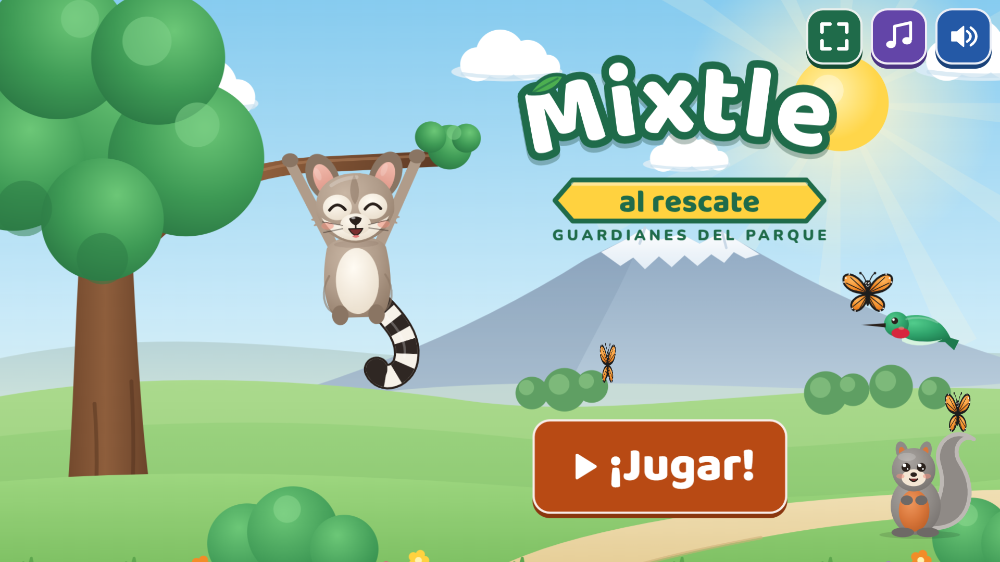

**Tráiler (39 s, con la música del juego; grabado con la voz anterior de Mixtle):** [`docs/trailer/mixtle-al-rescate.mp4`](docs/trailer/mixtle-al-rescate.mp4).

## Qué cambió en la v3

La v3 le da al juego su propia marca y lo hace más llamativo en el proyector, con técnicas de marketing y de diseño de juegos usadas de forma ética para niñas y niños de 6 a 8 años (ver *Diseño persuasivo responsable*).

| v2 | v3 |
|---|---|
| "Caco al rescate" | **"Mixtle al rescate"**, con el lema **"Guardianes del parque"**. Marca propia (dirección visual A, *Parque de día*): logo en SVG, ícono de la app, pantalla de carga y hoja de personaje de Mixtle con 8 poses. Guía en [`docs/marca.md`](docs/marca.md). |
| Inicio estático | **Inicio animado**: el parque en capas con paralaje y el Nevado de Toluca al fondo, Mixtle que llega columpiándose de una rama y el logo que aterriza con su remate musical. **Transición de marca** entre secciones y **modo vitrina** (demo en bucle si nadie toca el inicio 60 s en el proyector). |
| Banner de respuesta | **Cada toque responde** (los botones se aplastan, suenan y sueltan chispas). Al acertar: lluvia de hojitas, la hojita ganada vuela al contador y el número sube contando, y Mixtle celebra distinto cada vez. **Racha dentro de la lección** ("¡3 seguidas!") y una pequeña celebración a la mitad. |
| Cofre y estampa sencillos | El **cofre** dice desde antes lo que trae, se sacude, brilla y estalla. La **estampa** se voltea con brillo. El **parque** cambia "Antes → ¡Ahora!" con su sonido. **Fin de unidad** con minicelebración y **diploma imprimible** (cabe en una hoja carta o A4). |
| Un fondo para todo | **Cada unidad con su ambiente y su paleta**: Parque (su estación de reciclaje), Hogar de los animales (un humedal), Bosque del Nevado de Toluca, Calles de Toluca (portales con arcos y un edificio de grandes vitrales inspirado en el Cosmovitral, dibujados de forma original) y Escuela. El ambiente **decora los lados del camino** (árboles y bancas, tules y estanques, pinos y rocas, casas de colores y bicis, la escuela y una canasta), y arriba del camino **el parque del grupo es el protagonista**, con su marco y su título. |
| — | **Vestidor**: accesorios para la mascota del grupo (flor, gorra, lentes, paliacate, mochila y capa) a precio fijo en hojitas, y **antes de gastar pregunta** ("¿Compran los lentes por 40 hojitas?", con la mascota ya puesta); se ve en el camino y en el diploma. |
| Arte plano | **Arte más rico**: luz, sombras suaves, degradados y una textura de papel, con trazo y paleta iguales en todo el juego. |
| Kokoro | Voz con **Azure AI Speech**: Mixtle habla con **Alejo** (`es-MX-Alejo:MAI-Voice-2-Flash`, español de México, estilo «excited»), elegido entre las [muestras de 12 voces](docs/muestras-voz/azure.html). Kokoro queda como alterno. |
| "N días seguidos" en el camino | **Se quitó la racha de días** (se perdía al faltar un día) y las hojitas de cada grupo ya no se ven lado a lado al elegir grupo: no se comparan grupos. |

Medido en esta versión: lo que baja antes de la primera pantalla pesa **235.6 KB** comprimidos (límite 250 KB), y en la laptop de 8 GB el juego va a **59–60 cuadros por segundo** en sus momentos más pesados (ver *Pruebas y evidencia medida*).

### Capturas de la v3

Regeneradas con `node scripts/capturas-v3.mjs` (proyector 1920×1080 y tablet 1024×768, en `docs/capturas/*-v3-*.png`).

| Inicio | Camino |
|---|---|
|  | 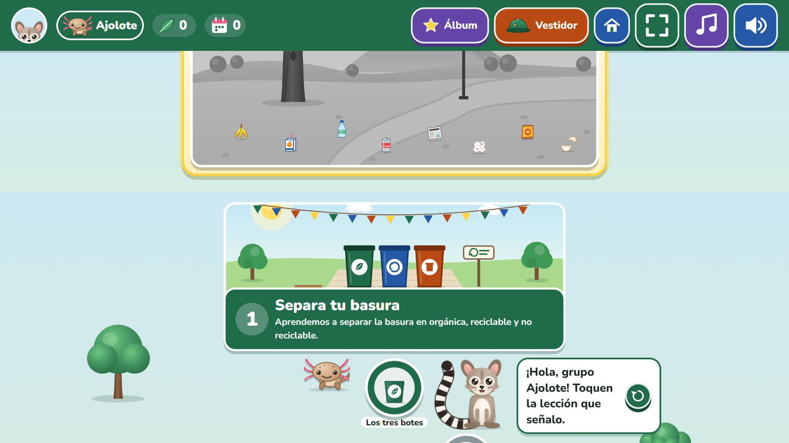 |
| **Acierto en una lección** | **Cofre** |
| 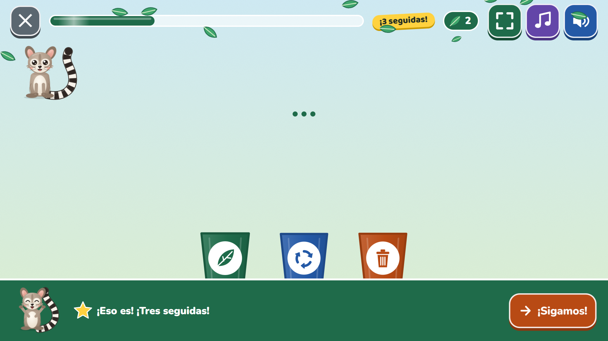 | 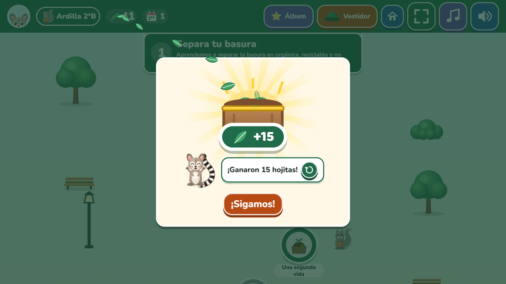 |
| **Fin de unidad** | **Diploma** |
| 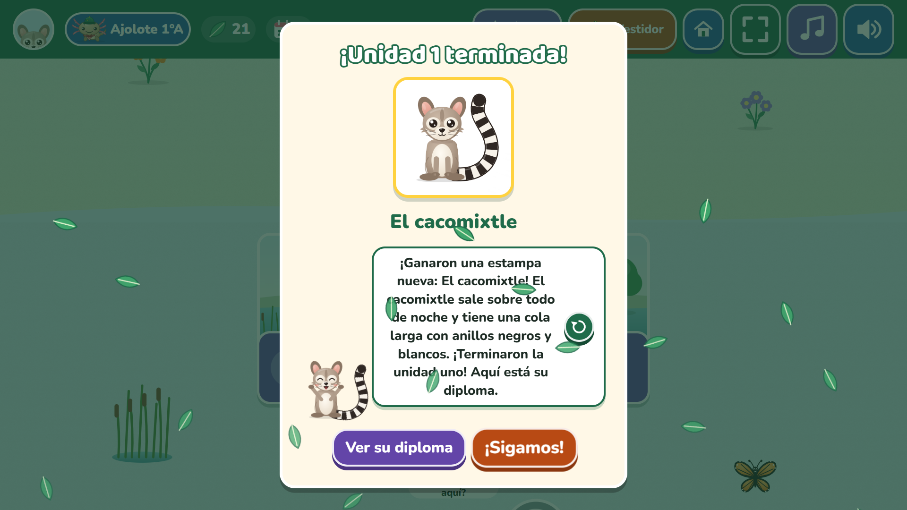 | 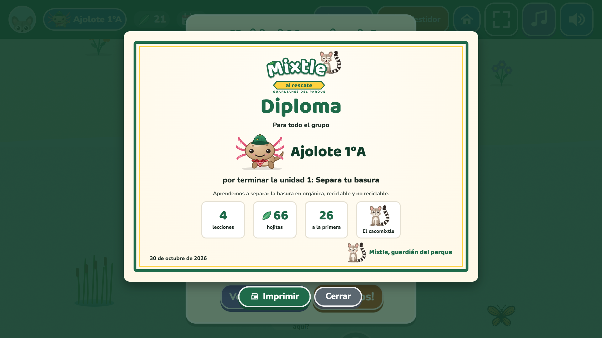 |
| **Vestidor** | **Tablet: el camino** |
| 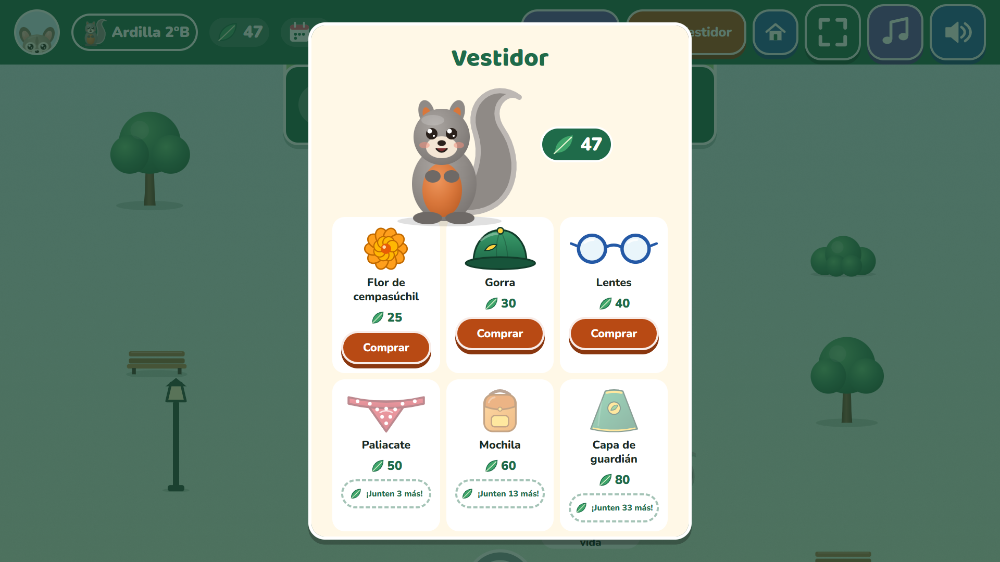 | 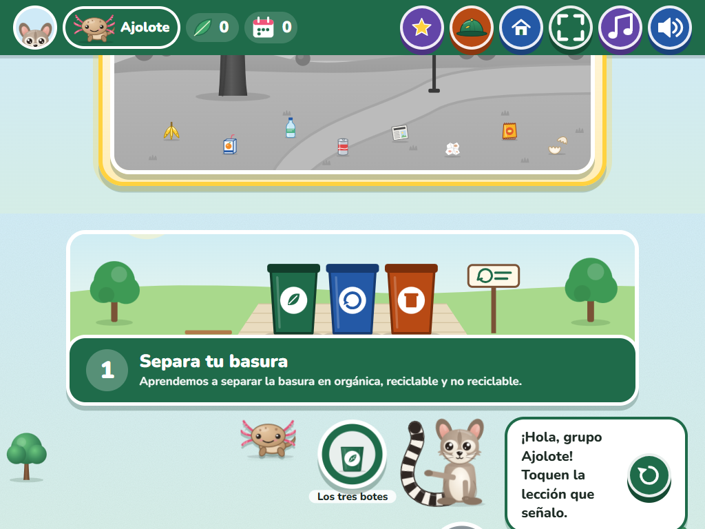 |

### Tráiler

[`docs/trailer/mixtle-al-rescate.mp4`](docs/trailer/mixtle-al-rescate.mp4): 39 s, 1920×1080, con la música del juego (pista "lecciones"). Muestra el inicio, la entrada al camino, una lección con "¡3 seguidas!", el cofre, el parque que se transforma, la aventura en bici y el cierre con el logo. **Se grabó con la voz anterior de Mixtle** (Kokoro `em_alex`), antes de cambiar a Alejo de Azure; no se volvió a grabar.

Se regenera con `npm run build && node scripts/trailer.mjs`. El script juega de verdad en Chrome con tarjeta de video y graba cada momento aparte con el screencast de Chrome, con la hora exacta de cada cuadro (el video continuo de Playwright se desfasaba). Luego ffmpeg los une con fundidos y la música. Si durante algún momento el juego se dibuja a menos de 40 fps (la computadora estaba ocupada), se detiene en lugar de armar un tráiler a saltos.

### Revisión de René (28 de octubre de 2026)

Después de jugar la v3 se corrigió:

1. **Mixtle tiene su cola anillada en todas sus poses**: también colgado del árbol del inicio (la cola le cuelga y se enrosca), en la estampa, como mascota, en el parque del grupo, en el diploma, en la transición y en la hoja de personaje. Una prueba revisa que no falte.
2. **La mascota del grupo no tapa nada en el camino**: va junto a la burbuja de la siguiente parada, más baja que ella y del lado contrario a Mixtle. Se revisó con cajas reales en las 9 posiciones del zigzag, a 1920×1080 y 1024×768 (18 de 18, `scripts/demo/revisar-ficha.mjs`), y queda una prueba e2e (`e2e/ficha.spec.ts`).
3. **El ambiente de cada unidad decora los lados del camino**, detrás del contenido y sin tocar nada. Medido en las mismas condiciones, sin tarjeta de video: con decoraciones, 55/60 fps (proyector/tablet); sin ellas, 56/60.
4. **No se ven dos parques seguidos**: el parque del grupo es el protagonista (marco dorado, "El parque de …" y su mascota), y la postal de la unidad 1 ahora es la estación de reciclaje del parque.

Además, el encabezado del camino ya cabe en una línea en la tablet: 80 px de alto en lugar de 177, con botones de 64 px.

## Qué cambió en la v2

| v1 | v2 |
|---|---|
| Una sola partida de 5 pantallas (Phaser) | **Camino de aprendizaje** con 5 unidades, 20 lecciones y 5 aventuras |
| Voz del navegador (distinta en cada equipo) | **Voz pregenerada** de Mixtle (Azure, Alejo «excited»), igual en todos lados, más música CC0 con *ducking* |
| Nada se guardaba | **Grupos de salón** (animal mascota, color y etiqueta como "1°A"); el avance se guarda en el aparato |
| Solo arrastrar a los botes | **7 tipos de ejercicio** dirigidos por datos |
| Diploma al final | Hojitas, parque del grupo que crece, cofre, álbum de animales de Toluca, días jugados y **diploma por unidad** |
| Todo en Phaser | Interfaz en **React + Tailwind + Motion**; Phaser solo dentro de las aventuras (se descarga al entrar y se destruye al salir) |

La aventura de la unidad 1 son los tres niveles de la v1, adaptados al camino, y un bonus nuevo sin cámara: **"Lluvia de basura"**. **El juego ya no usa la cámara** en ninguna parte (se quitó a petición de Eco Urban): no pide permisos ni descarga modelos de visión.

## Cómo se juega

1. **Inicio → ¿Quién va a jugar?** Se elige el grupo o se crea uno: un animal (colibrí, ardilla, monarca, ajolote, tlacuache o cacomixtle), un color y, si se quiere, una etiqueta corta como "1°A". **Nunca se piden nombres de niñas ni niños**, y la pantalla lo recuerda.
2. **El camino.** Arriba está el **parque del grupo**: empieza gris y con basura, y se limpia y llena de árboles, flores y animales conforme el grupo avanza. Abajo, el camino en zigzag, por tramos: cada unidad con su postal y su paleta. En cada tramo están sus lecciones, un **cofre** a la mitad y la **aventura** al final. Mixtle se para junto a la siguiente lección y la señala, y la mascota del grupo (vestida) brinca a su lado. Las lecciones se abren en orden y las terminadas se pueden repetir.
   - **Recorrido guiado (la primera vez de cada grupo).** La primera vez que un grupo llega al camino, Mixtle enseña para qué sirve cada cosa, una a la vez y en voz alta: la siguiente parada, el parque, las hojitas, los días jugados, el álbum, el vestidor, la casita para cambiar de grupo y los botones de pantalla completa, música y voz. Lo señalado se ilumina con un marco dorado y lo demás se oscurece. **«Saltar» está a la vista desde el primer paso** (también Escape), y hay «Atrás» y «Siguiente» (o las flechas del teclado). Se recuerda **en el avance del grupo, no en el aparato** (muchos maestros usan su propio dispositivo con niños distintos en cada grupo): ya visto o saltado por ese grupo, no vuelve a salir; los grupos que ya existían antes de esta marca no lo ven otra vez; para verlo otra vez está **«Ver otra vez el recorrido por el juego»** en el modo facilitador. Con `?e2e` no sale (pruebas, capturas y tráiler), salvo con `?recorrido-guiado`. Se revisó en el juego a 1920×1080 y 1024×768: en los 20 pasos, la tarjeta nunca tapa lo señalado y nada se sale de la pantalla.
3. **Una lección** (6 a 8 ejercicios, unos 3 minutos). Barra de avance arriba, botón para salir con confirmación amable, y Mixtle narra cada consigna.
   - **Bien:** banner verde, lluvia de hojitas, Mixtle celebra (distinto cada vez) y dice una frase de ánimo. Si salió a la primera, la hojita ganada vuela al contador. Con 3, 5, 7 o 10 seguidas a la primera, "¡3 seguidas!".
   - **Casi:** banner naranja con una pista y "Intentar otra vez". No hay vidas ni castigos; lo que salió mal vuelve al final para repasar.
   - **A la mitad:** destello en la barra y "¡Ya van a la mitad! ¡Vamos!".
   - **Al terminar:** las hojitas de terminarla vuelan al contador, cuántos ejercicios salieron a la primera, el parque "Antes → ¡Ahora!" y el jingle.
4. **Recompensas.** Hojitas por lección y por cofre (el cofre dice desde antes cuántas trae); una **estampa del álbum** por cada unidad terminada (cacomixtle, mariposa monarca, colibrí, ajolote de montaña y tlacuache, cada una con un dato narrado) y su **diploma imprimible**; los **días jugados**, que solo suben, sin culpa ni presión si un día no se juega.
5. **Vestidor.** Con las hojitas se compran accesorios para la mascota del grupo, a precio fijo y a la vista. Antes de gastar, Mixtle pregunta en voz alta ("¿Compran la gorra por 30 hojitas?"). La ventana muestra la mascota ya con el accesorio, el precio y dos botones iguales, "Sí, comprar" y "No, todavía no" (también se cierra con Escape). Ninguno late, para no empujar a comprar, y un toque por accidente no se lleva las hojitas. Si no alcanza, no pregunta: se ve cuántas faltan. Lo comprado nunca se pierde.

| Lección: un error con pista | Lección terminada |
|---|---|
| 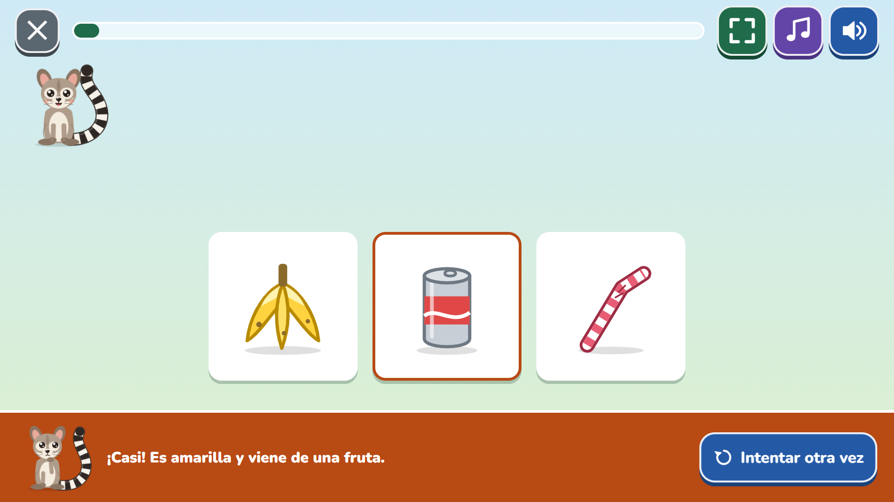 | 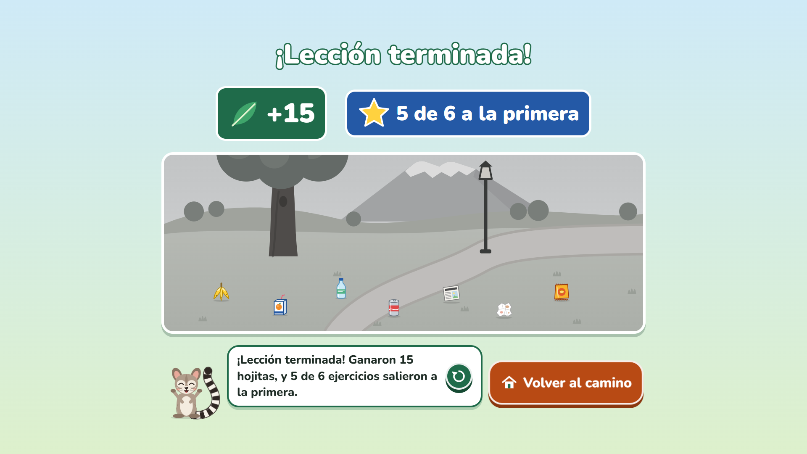 |
| **Aventura de la unidad 2** | **Diploma de unidad** |
| 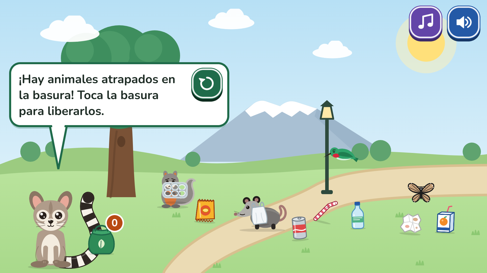 | 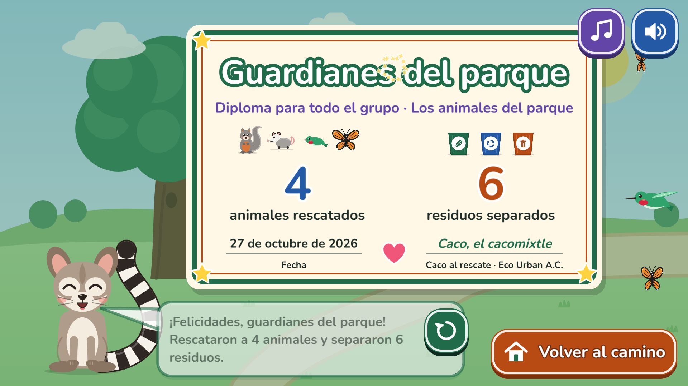 |

### Las cinco unidades

| Unidad | Lecciones | Aventura | Estampa |
|---|---|---|---|
| 1. Separa tu basura | Los tres botes · Basura en su lugar · Una segunda vida · ¿Y si se revuelve? | **Limpia el parque**: los 3 niveles de la v1 y el bonus "Lluvia de basura" (cae una basura a la vez y se toca su bote; si llega al suelo, vuelve a caer) | Cacomixtle |
| 2. Los animales del parque | ¿Quién vive aquí? · La basura los lastima · Nada de comida chatarra · Vecinos de Toluca | **Rescate en el parque**: liberar animales atrapados en basura y separarla | Mariposa monarca |
| 3. Árboles y áreas verdes | ¿Para qué sirven? · Plantamos un árbol · Lo cuidamos · Casa de animales | **Siembra un bosquecito**: plantar seis arbolitos y regarlos hasta que crezcan (amplía el nivel 3 de la v1) | Colibrí |
| 4. Aire limpio | A pie o en bici · ¿Qué es el humo? · Días de contingencia · Cuidamos el aire | **En bici a la escuela**: cambiar de carril para esquivar el humo y juntar hojitas | Ajolote de montaña |
| 5. Reduce y reutiliza | Mi botella y mi lonchera · Menos desechables · Una segunda vida · Menos basura | **Mi lonchera sin basura**: cada cosa a la lonchera o a "Mejor no" | Tlacuache |

### Los 7 tipos de ejercicio

Todos funcionan con toque y con mouse, con zonas de toque de 64 px o más.

1. **Elige la imagen:** Mixtle pregunta y se toca una de 2 a 4 tarjetas.
2. **Al bote:** se arrastra cada residuo a su bote (o se toca el bote). Usa la lógica de la v1.
3. **Parejas:** se toca una tarjeta y luego su pareja (residuo y bote, animal y su comida, animal y su casa).
4. **¿Sí o no?:** una acción ilustrada y dos caritas propias (feliz y triste), que se distinguen por la boca y no solo por el color.
5. **Ordena los pasos:** se tocan 3 o 4 tarjetas en orden (cómo se planta un árbol).
6. **Encuentra el error:** una escena con 1 a 3 cosas mal (basura en el pasto, una llave goteando, basura quemándose).
7. **Escucha y toca:** Mixtle nombra algo y se toca su dibujo, sin texto. Es para quienes todavía no leen.

### Modo facilitador

Para la persona que facilita: **mantén presionado el logo de Mixtle (arriba a la izquierda) 3 segundos.** Ahí se puede reiniciar el avance del grupo, **borrar el grupo** (con confirmación; antes no había forma de borrar uno), abrir todas las lecciones para saltar directo a una, activar el **modo proyector** (todo más grande) y las **animaciones suaves** (menos movimiento, para quien se marea o se distrae; el juego también las enciende solo si el equipo no sostiene las animaciones), ver otra vez el recorrido guiado y revisar si el juego ya está **listo para usar sin internet**.

- **Grupo de demostración.** El botón **"Crear grupo de demostración"** crea un grupo "Demo" (un cacomixtle) como si hubiera terminado las 5 unidades: todas las lecciones (cada ejercicio a la primera), los cofres y las aventuras, las 5 estampas, el parque lleno, los 5 diplomas y hojitas para comprar todos los accesorios. Sirve para enseñar el juego completo en una reunión sin jugarlo. Queda elegido, no toca el avance de los grupos reales y se borra como cualquier otro. Pruebas en `tests/grupoDemo.test.ts` y `tests/panelFacilitador.test.tsx`.

## Nombre y dirección anteriores

Hasta la v2, el personaje se llamaba **Caco** y el juego, "Caco al rescate" (la versión que vio Eco Urban está en la etiqueta de git `v2-eco-urban`). Desde la v3 se llama **Mixtle**, y el juego, **"Mixtle al rescate"**, con el lema **"Guardianes del parque"**. La palabra "cacomixtle" se queda donde nombra al animal.

- **Dirección:** el juego está en <https://mixtle-al-rescate.vercel.app>. Si se abre la dirección anterior, <https://caco-al-rescate.vercel.app>, el juego empaca los grupos y las preferencias de ese navegador, borra su copia sin conexión y abre la dirección nueva con todo eso en el fragmento de la URL (`#mudanza=…`, que nunca se envía a ningún servidor). En la dirección nueva, los grupos se juntan con los que ya hubiera, sin perder ninguno. Lo hace `src/servicios/mudanza.ts` y `mudarse.ts`.
- **Datos guardados con el nombre anterior** (IndexedDB `caco-al-rescate` y las claves `caco-al-rescate:*` de `localStorage`) pasan solos a `mixtle-al-rescate` al abrir el juego (`src/servicios/migracion.ts`, con pruebas en `tests/migracion.test.ts`).
- **Repositorio:** `renecano/mixtle-al-rescate` (GitHub redirige el nombre anterior).
- **Carpeta local:** se sigue llamando `caco_al_rescate` en la laptop donde se desarrolló; no se renombró porque se estaba trabajando en ella. No afecta en nada al juego.

## Direcciones visuales de la v3

`docs/direccion-visual/index.html` muestra tres direcciones para la v3 (A · Parque de día, B · ¡Al rescate!, C · Fiesta del Nevado): logo con Mixtle, inicio, lección, recompensa, paleta, tipografía y contraste WCAG medido en la misma página. Usa el arte real del juego (`npm run docs:direccion` lo exporta de `src/arte/`). **Elegida: A · Parque de día** (28 de octubre de 2026). La guía de marca está en [`docs/marca.md`](docs/marca.md).

## Correrlo en Windows

Requisitos: [Node.js](https://nodejs.org) 22.12 o más nuevo (la versión LTS sirve) y Chrome o Edge.

```powershell
npm install
npm run dev
```

Abre <http://localhost:5173> en Chrome o Edge. Para proyectar, usa el botón de pantalla completa del juego (o F11).

Todos los comandos son scripts de npm; ninguno necesita bash. Funcionan en PowerShell o en el símbolo del sistema.

| Comando | Qué hace |
|---|---|
| `npm run dev` | Juego en modo desarrollo, con recarga automática |
| `npm run build` | Genera el sitio estático en `dist/` (con su *service worker* para jugar sin internet) |
| `npm run preview` | Sirve `dist/` para probar la versión final |
| `npm test` | Pruebas unitarias (Vitest) |
| `npm run test:e2e` | Recorridos completos en el navegador (Playwright) |
| `npm run verificar` | Tipos + lint + pruebas + build, todo junto |
| `npm run voz:generar` / `voz:lista` | Voces de Mixtle y lista de frases para grabar (ver abajo) |
| `npm run voz:silencio` | Mide cuánto silencio tienen los audios de la voz (duración, silencio, hablado, fuerte, MB) |
| `npm run actualizacion:probar -- --antes=… --despues=…` | Reproduce el paso de una versión guardada a una nueva (ver *Cuando se publica una versión nueva*) |
| `npm run capturas` | Regenera las capturas de `docs/capturas/` jugando un recorrido (con `npm run preview` abierto) |

Atajos para revisar (solo en desarrollo o con `?e2e` en la dirección): `?galeria` muestra todo el arte; `?escena=Rescate&unidad=u2` entra directo a una aventura (`Bosque`/`u3`, `Bici`/`u4`, `Lonchera`/`u5`, o una escena de la v1 como `Nivel2`).

## Desplegar en Vercel

El proyecto es un sitio estático y ya incluye `vercel.json` (Vite, `npm run build`, carpeta `dist`, cabeceras de seguridad y caché; el *service worker* nunca se guarda en caché para que las actualizaciones lleguen).

**Versión estable y cómo volver a ella.** La etiqueta `v3-estable` (commit `cb13f92`, 29 de octubre de 2026) marca la versión revisada con los cinco puntos de René, la voz de Alejo recortada y la actualización automática. Si una versión posterior sale mal, hay dos formas de volver:
- **Instant Rollback en Vercel:** en el proyecto → *Deployments* → el despliegue de `cb13f92` → ⋯ → *Instant Rollback* (o *Promote to Production*). Es inmediato y no toca el repositorio; las laptops lo reciben como cualquier versión nueva (ver *Cuando se publica una versión nueva*).
- **Con git:** `git revert --no-commit v3-estable..main && git commit -m "Volver a v3-estable"` y `git push`. Deshace los commits posteriores sin reescribir la historia; Vercel publica el resultado.

**Hoy:** el repositorio es privado en GitHub (`renecano/mixtle-al-rescate`) y el proyecto de Vercel `mixtle-al-rescate` está conectado a él: **cada *push* a `main` se publica solo en producción** (<https://mixtle-al-rescate.vercel.app>). El primer despliegue automático falló porque `vercel.json` tenía un patrón de cabeceras que Vercel no acepta; ya está corregido (una regla por archivo del *service worker*).

**Con GitHub (recomendado):** en [vercel.com](https://vercel.com), *Add New → Project* e importa el repositorio. Cada rama o *pull request* genera una **versión de prueba** (*preview*) con su propia dirección; lo que llega a `main` se publica en **producción**. Así Eco Urban puede revisar cambios antes de que lleguen a los salones.

**Desde la terminal:**

```powershell
npx vercel          # versión de prueba
npx vercel --prod   # producción
```

**Integración continua:** `.github/workflows/ci.yml` corre en cada *push* y *pull request*. Revisa tipos, lint, pruebas y build en Ubuntu **y en Windows**, y después los recorridos en el navegador.

## Editar el contenido

Todo el contenido vive en archivos de datos, separado de la lógica, para que el equipo educativo lo revise y lo cambie. Cada archivo está marcado con `TODO(Eco Urban)`.

- **`src/contenido/unidades/u1-separa.ts` … `u5-reutiliza.ts`:** una unidad por archivo, con su título, tema, color, cofre, estampa (con su dato), aventura y lecciones. Cada lección es una lista de ejercicios; cada ejercicio tiene `tipo`, `consigna`, `pista` y sus datos. Los tipos están documentados en `src/contenido/tipos.ts`. Los dibujos se nombran por su clave; para verlos todos, abre `?galeria`.
- **`src/contenido/aventuras.ts`:** lo que dice Mixtle en las aventuras 2 a 5 y en su diploma.
- **`src/contenido/textosApp.ts`:** lo que dice Mixtle en las pantallas (grupos, camino, cofre, lección, álbum).
- **`src/data/residuos.ts` y `src/data/categorias.ts`:** los residuos y los botes, configurables como en la v1 (de 2 a 4 botes cambiando solo `categorias.ts`; los ejemplos están al final del archivo).

Las pruebas revisan que el contenido sea válido: 4 o 5 lecciones por unidad, de 6 a 8 ejercicios con al menos 3 tipos distintos, respuestas correctas que existen, dibujos que existen, ningún ejercicio imposible y todos los residuos con exactamente un bote.

**Datos verdaderos.** Cada dato que dice Mixtle tiene su fuente en [`docs/fuentes-contenido.md`](docs/fuentes-contenido.md) (CONABIO, CONANP, SEMARNAT, CONAFOR, UNAM, OMS, EPA, entre otras). Ahí también está lo que **no** se usa por no tener fuente confiable (por ejemplo, "un popote tarda 500 años en degradarse"). Si se agrega un dato, hay que anotar su fuente.

Después de cambiar cualquier texto, corre `npm run voz:generar` para que Mixtle lo diga con su voz.

## Voz de Mixtle y música

### Cómo se generan las voces

Mixtle habla con audios **pregenerados** que están en el repositorio (`public/voz/`). El juego solo los reproduce: no sintetiza voz en el navegador ni llama a ningún servicio. La voz es **Alejo** de Azure AI Speech (`es-MX-Alejo:MAI-Voice-2-Flash`, español de México, estilo «excited»), elegida por René entre las muestras de `docs/muestras-voz/azure.html`. Azure se usa solo al **generar** los audios, en el plan gratuito. Kokoro `em_alex` queda como alterno (`npm run voz:usar -- kokoro`).

Para regenerarlas, en PowerShell:

```powershell
npm run voz:preparar   # solo la primera vez: crea .venv-voz (Python 3.10–3.12) y descarga los modelos (~250 MB)
npm run voz:generar    # genera solo las frases nuevas o cambiadas
```

- **Qué necesita.** `voz:preparar` busca un Python 3.10–3.12; si no lo encuentra, dice cuál instalar. ffmpeg y espeak-ng vienen dentro de los paquetes de Python.
- **Qué hace `voz:generar`:**
  - junta automáticamente todo lo que dice Mixtle desde los archivos de contenido (`src/voz/frases.ts`), incluidas las unidades, las lecciones y las aventuras;
  - aplica `voz.config.json` (proveedor, voz, velocidad y diccionario de pronunciación);
  - guarda `public/voz/<hash-del-texto>.mp3` (mono, 64 kbps, volumen normalizado) y `public/voz/manifiesto.json`;
  - solo regenera las frases cuyo texto o configuración cambiaron, y borra los audios que ya no se usan.
- **Pronunciación.** El diccionario de `voz.config.json` cambia cómo se lee una palabra solo en el audio ("Mixtle" → "Míkstle" y "cacomixtle" → "cacomíkstle": las dos con "ks", como en "mix"). El texto en pantalla no cambia.
- **Números.** Las frases con números que de verdad pueden salir (el resumen de cada lección para cada resultado, el cofre y los diplomas) se graban **completas**, para que Mixtle las diga de corrido: encadenar piezas sonaba entrecortado. Como respaldo, para cualquier otro número se pregeneran del 0 al 100 (con "un" y "veintiún" antes de sustantivo) y se encadenan, cargando todas las piezas antes de empezar a hablar. La lista está en `narracionesCompletas()` de `src/voz/frases.ts`.
- **Respaldo.** Si una frase no tiene audio, el juego usa la voz del navegador y, en desarrollo, lo avisa en la consola. Una prueba unitaria revisa que **toda** frase narrada tenga su audio en el manifiesto.
- **En una máquina lenta** se puede generar por partes: `npm run voz:generar -- --max=50`. Cada corrida sigue donde se quedó la anterior.

### Voz con Azure AI Speech

La v3 deja listo **Azure AI Speech** como proveedor (`scripts/voz/azure.mjs`: API REST con `fetch` y SSML, sin SDK). Kokoro sigue como alterno, y las grabaciones humanas siguen teniendo prioridad sobre las dos.

- **La llave.** En `.env.local` (ya está en `.gitignore`), **sin** el prefijo `VITE_`, para que Vite nunca la mande al navegador:

  ```
  AZURE_SPEECH_KEY=…
  AZURE_SPEECH_REGION=francecentral
  ```

  La llave solo se usa al **generar** los audios en la computadora de quien prepara el juego. El juego publicado sigue reproduciendo mp3 pregenerados y nunca llama a Azure. `tests/llave.test.ts` revisa que `.env.local` esté ignorado, que el código del juego no lea la llave y que ni el repositorio ni `dist/` contengan su valor (se comprobó plantando una llave falsa en `dist/`: la prueba falla).
- **Elegir la voz.** `npm run voz:muestras -- --proveedor=azure` consulta las voces es-MX y es-US de la región y genera las mismas frases (saludo, acierto, pista amable, dato curioso) con cada una: normal, con estilo alegre si la voz lo tiene, tono +5 % y +10 % y un poco más lenta, más cómo dice "Mixtle" y "cacomixtle". La página `docs/muestras-voz/azure.html` incluye la voz actual (Kokoro) para comparar y se puede mandar a Eco Urban. Gasta como máximo ~20,000 caracteres.

  **Muestras generadas (29 de octubre de 2026, región francecentral).** La región tiene 33 voces es-MX/es-US, 11 de ellas con estilos. Entraron 12 voces con 241 audios y se gastaron 19,107 caracteres. Las 12 son Alejo y Valeria (MAI-Voice 2 y 2.1), Harper (MAI-Voice 2.1), Jorge, Beatriz, Candela, Carlota, Cecilio, Dalia y Dalia Multilingual. Las voces nuevas **MAI-Voice** traen `:` en el nombre (`es-MX-Alejo:MAI-Voice-2-Flash`). En Windows, eso escondía el audio en un flujo alterno en lugar de crear el archivo, así que ahora el nombre del archivo cambia `:` por `_` (con una prueba en `tests/azure.test.ts`). Los 241 audios se revisaron decodificándolos con ffmpeg: ninguno tiene errores.
- **Cambiar la voz.** `npm run voz:usar -- azure` (o `kokoro`) cambia el proveedor activo; la voz y los ajustes de cada uno (`voz`, `idioma`, `estilo`, `tono`, `velocidad`) están en `voz.config.json`. Después, `npm run voz:generar`. La firma de cada audio incluye proveedor, voz, estilo, ajustes, normalización y texto, así que un cambio regenera lo necesario y nada más.
- **El nombre de cada mp3 lleva la voz.** Se publica como `voz/<hash-del-texto>.<hash-de-la-configuración>.mp3` (o `.h<huella>` si es una grabación humana). Antes era solo el hash del texto, así que al cambiar de voz el archivo conservaba el nombre con otro contenido y cualquier caché (el navegador, el *service worker*, la descarga sin internet) podía servir la copia vieja. Ahora un cambio de voz o de normalización es una URL nueva en todas partes; el manifiesto sigue buscando cada frase por el hash de su texto (`archivo` dice el mp3 real), y las grabaciones humanas se siguen nombrando por ese hash. `tests/vozArchivos.test.ts` revisa que cada entrada nombre su archivo con su configuración, que exista, que no haya dos iguales ni mp3 sueltos.
- **Costo.** El plan gratuito (F0) da 500,000 caracteres al mes. Todas las frases del juego suman 38,902 (las 785 de hoy): regenerar todo cabe más de 10 veces al mes. Generar la voz de Alejo costó 38,902 caracteres; con las muestras, el mes va en 58,009. Si una corrida se corta, la siguiente reusa los audios ya pedidos con la misma firma (voz, estilo, ajustes y texto), sin volver a pagarlos. Antes de cada corrida se cuentan los caracteres y el uso del mes se lleva en `.voz-uso.json` (local, ignorado por git); si el mes pasaría de **400,000**, se detiene, salvo con `--forzar`. Entre peticiones espera ~3 s y reintenta los 429 con espera creciente.
- **Pruebas.** `tests/azure.test.ts` corre todo contra un servidor falso (SSML, lista de voces, reintento de 429, presupuesto, página de muestras). También se probó `voz:generar` completo contra un servidor falso: SSML con estilo y tono, reintento, normalización y registro de uso.

### El silencio de la voz (recorte)

René revisó la voz de Alejo: en 16 audios al azar, el 32 % del tiempo era silencio. Por ejemplo, el diploma de la unidad 4 ("…Hojitas que juntaron: cero. Nubes de humo que esquivaron: siete…") duraba 17.2 s con 9.8 s de silencio, y "desechables." traía 0.9 s. Medido en todos los audios con `npm run voz:silencio` (silencio = pausas de 0.1 s o más por debajo de −50 dB), antes era el **30.1 %** (29 de octubre de 2026).

**Qué se hizo.**
1. **Recorte al normalizar** (`voz.config.json` → `normalizacion`, aplicado en `scripts/voz/sintesis.py` a todo audio, venga de Azure, de Kokoro o de una grabación humana): se quita el silencio del inicio y del final dejando 80 ms, y las pausas internas de más de 0.5 s se acortan a 0.35 s (`silenceremove` de ffmpeg, antes de `loudnorm`). Cambiar esos parámetros vuelve a convertir todos los audios desde los originales guardados **sin pedir nada nuevo a Azure**: la firma con la que se reusa el original no incluye la normalización (`scripts/voz/firmas.mjs`).
2. **Las frases con dos puntos se reescribieron de corrido.** El diploma de la unidad 4 ahora dice "¡Felicidades, guardianes del aire! Juntaron diez hojitas y esquivaron siete nubes de humo. ¡Bravo!" (8.4 s, 1.2 s de silencio), con "una hojita" y "una nube de humo" en singular (los números femeninos existen ahora como piezas: "una", "veintiuna"…). Si juntaron cero hojitas o esquivaron cero nubes, no dice "cero": anima para la próxima vez, como el resumen de lección. También se reescribieron "…su siguiente parada. ¡Tóquenla para jugar!" y "No pasa nada, ahí viene otra vez". Los títulos y temas de las unidades ("Unidad 2: Los animales del parque") y "¡Ganaron una estampa nueva: El tlacuache!" se dejaron como están: son texto en pantalla, y el recorte ya acorta su pausa.
3. **Los sonidos sueltos vienen del estilo «excited».** 22 audios traían un sonido corto después de una pausa larga (en "tres", "once", "sesenta y un"…). Se pidieron esas frases con y sin estilo: sin el estilo no pasa nunca; con él, cambia de una toma a otra (dos de tres tomas de "tres" salieron limpias). Así que no se corta nada: para las frases cortas (hasta tres palabras, donde un sonido tras una pausa larga no puede ser texto), el generador pide hasta tres tomas y se queda con la más limpia (`scripts/voz/sonidoSuelto.mjs`). Quedó una con sonido suelto tras tres tomas: la pieza "hojitas, y", que solo se usa de respaldo (los resúmenes de lección están grabados completos). No se probó `<break>` en SSML: el recorte y las retomas bastaron.

**Medido antes y después** (`docs/voz-silencio-antes.json`, `-despues.json`, `-comparacion.json`):

| | Antes (785 audios) | Después (798 audios) |
|---|---|---|
| Duración total | 3,840.6 s | **3,125.3 s** |
| Silencio | 1,154.2 s, **30.1 %** | 488.9 s, **15.6 %** |
| `public/voz` | 30.91 MB | **25.19 MB** |
| El diploma del ejemplo | 17.2 s, 9.8 s de silencio | 8.4 s, 1.2 s |
| "desechables." | 1.9 s, 0.9 s de silencio | 1.1 s, 0.0 s |

**Que no se cortaran sílabas.** En los 673 audios cuyo texto no cambió, el tiempo por encima de −35 dB (las sílabas) suma 1,606.2 s antes y 1,611.7 s después; el silencio en ellos bajó de 25.2 % a 13.3 %. Por archivo, los únicos que perdieron más de 50 ms de ese tiempo fueron tres tomas nuevas de Azure ("once", "tres", "sesenta y un": el sonido suelto ya no está) y "Es de metal y tiene forma de vaso." (87 ms): se revisaron sus tramos fuertes uno por uno y todos siguen ahí con la misma duración, con diferencias de hasta 20 ms en los bordes por la nueva ganancia de `loudnorm`. Los 798 se decodificaron con ffmpeg sin errores. Lo que queda de silencio son las pausas de hasta 0.5 s y los respiros del estilo, que están por encima de −50 dB.

**Lo que gastó en Azure:** 10,992 caracteres (131 frases nuevas: las 125 del diploma de la unidad 4, las 2 reescritas y las piezas femeninas, más 6 retomas por sonido suelto). El mes va en 69,265 de 400,000. Los 667 audios cuyo texto no cambió se reusaron de los originales guardados.

### Música y voz en el inicio

Los navegadores no dejan sonar nada hasta el primer toque (y está bien). Lo que cambió (29 de octubre de 2026):

- **Cualquier toque en el inicio arranca la música y desbloquea la voz**, no solo "¡Jugar!": el toque se escucha en toda la pantalla de inicio.
- **El botón de música la enciende con UN solo toque cuando el navegador aún la bloquea.** Antes había que tocarlo dos veces: el `pointerdown` del toque desbloqueaba el audio y arrancaba la música, y el `click` del mismo toque la apagaba. Ahora la música sabe cuánto hace que empezó a sonar (`musica.empezoHace`): si fue ese mismo toque (menos de 1 s), el botón no la apaga. Con la música ya sonando, el botón la apaga y la enciende como siempre.
- **Mientras esté bloqueada, un indicio sutil** abajo a la izquierda del inicio ("Toca la pantalla para escuchar") que desaparece con el primer toque. No sale si el navegador ya deja sonar (visita de regreso).
- **Si el navegador rechazó el primer intento de sonar, cada toque lo vuelve a pedir** (`musica.asegurar`). La primera comprobación falló justo por esto: la música se desbloqueaba una sola vez y nunca se reintentaba.

**Probado en Chrome con el autoplay bloqueado** (headless, con la política real de Chrome, `document-user-activation-required`): al abrir no suena y se ve el indicio; un toque en el fondo la arranca y quita el indicio; en una visita nueva, un solo toque en el botón la arranca sin apagarla; y ya sonando, el botón la apaga y la vuelve a encender (9 de 9). **Queda abierto:** con la bandera antigua `--autoplay-policy=user-gesture-required` (que Chrome ya no usa por defecto), el `<audio>` de la música queda "sonando" pero no avanza del segundo 0 aunque se toque; es el mismo síntoma que se vio al medir a través del proxy. No se probó en un iPad real.

### Grabar una voz humana

1. Corre `npm run voz:lista`. Genera `docs/frases-mixtle.csv` con columnas `id`, `archivo`, `texto`, `unidad` y `lección`; se abre bien en Excel.
2. Graba cada frase (por ejemplo, una persona de Eco Urban, o con Canva) y guarda el audio en `voz-grabaciones/` con el **mismo nombre de archivo** de la columna `archivo` (mp3, wav, m4a u ogg).
3. Corre `npm run voz:generar`. Las grabaciones reemplazan a la voz generada: se normalizan al mismo volumen y quedan marcadas como humanas en el manifiesto. Las frases sin grabar conservan la voz generada.

### Cambiar la música

Las tres pistas (tranquila, lecciones y celebración) son CC0 y están en `public/musica/`. Para cambiar una:

1. Agrega la candidata a `scripts/musica/candidatas.json` (solo CC0, con su página) y corre `npm run musica:muestras` para escucharla junto a las demás.
2. Pon su `id` en `scripts/musica/elegidas.json` y corre `npm run musica:instalar`.
3. Anótala en `CREDITOS.md`.

En el juego la música va baja (≈25 %), baja a ≈8 % mientras habla Mixtle y sube suave al terminar. Entre pistas hay un fundido, y solo empieza después del primer toque. Música y voz tienen botones separados, y cada uno se recuerda en el aparato.

Los efectos de sonido se generan con `npm run sonidos:generar`.

## Privacidad y datos

- **No se guarda nada de las niñas y los niños.** Los grupos se identifican con un animal, un color y una etiqueta corta; la pantalla pide no escribir nombres, y la etiqueta acepta solo 8 caracteres.
- El avance de cada grupo se guarda **solo en este aparato** (IndexedDB). No viaja a ningún servidor. Si el navegador bloquea el almacenamiento, el juego funciona igual y el avance dura mientras la página esté abierta.
- Las preferencias de voz, música y modo proyector se guardan en `localStorage`, siempre dentro de `try/catch`.
- **No se usa la cámara ni el micrófono.** `vercel.json` los bloquea con `Permissions-Policy: camera=(), microphone=()`.
- El juego **solo hace descargas** (peticiones GET). Las pruebas de recorrido verifican que no haya ninguna petición que envíe datos.

## Diseño persuasivo responsable

La v3 usa técnicas de marketing y de diseño de juegos para que el juego atraiga y motive. Todas apuntan a que el grupo **practique y se sienta capaz**, no a que pase más tiempo en la pantalla.

| Técnica | Dónde | Por qué es apropiada para 6 a 8 años |
|---|---|---|
| **Personaje guía** con personalidad y frase propia ("¡Al rescate!") | Mixtle en todo el juego | A esta edad aprenden mejor con un modelo cercano. Mixtle acompaña, explica y anima; nunca vende nada ni pide que vuelvan. |
| **Respuesta inmediata** a cada toque ("juice") | Botones, tarjetas, aciertos | Necesitan ver que su acción tuvo efecto. Se refuerza la acción, no la repetición compulsiva; no hay sonidos de "fallo". |
| **Meta visible y avance** | El parque del grupo, la barra con su celebración a la mitad | Hace concreto el resultado de su esfuerzo ("estamos salvando nuestro parque") y es un logro de todo el grupo. |
| **Recompensa por esfuerzo** | Hojitas por terminar y por acertar a la primera, diploma | Se gana por practicar. Un error no quita nada; lo que costó trabajo vuelve para repasar. |
| **Racha dentro de la lección** | "¡3 seguidas!" | Celebra la concentración del momento. Si hay un error, deja de verse sin decir nada; no cruza lecciones ni días. |
| **Anticipación sin azar** | El cofre se sacude, brilla y estalla | La emoción está en la animación. Lo que trae se dice y se ve desde antes. |
| **Coleccionar** | Álbum de animales de Toluca | Completar el álbum da orgullo y enseña fauna local. Las estampas no se compran: se ganan terminando unidades. |
| **Personalización** | Vestidor de la mascota del grupo | Da sentido de pertenencia y uso a las hojitas. El precio es fijo y está a la vista, nada se pierde y no hay dinero real. |
| **Identidad local** | Ambientes con el Nevado de Toluca, portales y vitrales | Reconocer su ciudad genera orgullo y hace relevante lo que aprenden. |
| **Vitrina** | Demo en bucle en el proyector, tras 60 s sin tocar | Sirve para ferias y reuniones. No narra y se quita con cualquier toque. |

**Lo que no se usa**, y cómo se cuida:

- **Sin anuncios ni compras.** No hay código de pagos ni de anuncios, y el juego solo hace descargas (las pruebas de recorrido revisan que ninguna petición envíe datos).
- **Sin premios aleatorios.** El cofre siempre trae 15 hojitas y Mixtle lo dice antes de abrirlo. Los accesorios tienen precio fijo. Hay pruebas para las dos cosas (`tests/recompensas.test.tsx`).
- **Sin rachas diarias que se pierdan ni mensajes de culpa.** Se quitó "N días seguidos"; solo se cuentan los días jugados, que nunca bajan (prueba en `tests/camino.test.ts`). Ante un error, Mixtle dice "¡Casi!" y da una pista.
- **Sin temporizadores que presionen y sin notificaciones.** No hay cuentas regresivas ni vidas. El juego no pide permisos de notificaciones.
- **Se premia el esfuerzo, no la comparación.** No hay tablas de posiciones. Al elegir grupo se ve cada mascota, no cuántas hojitas tiene cada uno. El diploma solo cuenta lo que hizo ese grupo.

## Pruebas y evidencia medida

**Mediciones de la v3** (28 de octubre de 2026, en la laptop de desarrollo: Intel Core i5-10210U, 8 GB):

| Qué | Resultado |
|---|---|
| Lo que se descarga antes de la primera pantalla | **235.6 KB** comprimidos, contando todas las fuentes (límite de la v3: 250 KB). `npm run presupuesto` lo mide en cada `verificar` y falla si se pasa. Las demás pantallas, el arte de los ambientes y los accesorios, Phaser, la voz y la música bajan después. |
| Cuadros por segundo, Chrome con tarjeta de video (`node scripts/medir-fps.mjs --con-ventana`) | **59–60 fps** en el inicio (entrada y paralaje), la lección con hojitas y chispas, el cofre que estalla y el camino. Hasta 0.7 % de cuadros lentos, a 1920×1080 y a 1024×768 (`docs/rendimiento-v3.json`). |
| Sin tarjeta de video (peor caso: Chromium sin ventana) | Con todas las animaciones, **11–14 fps** a 1920×1080 y 26–33 fps a 1024×768 (`docs/rendimiento-v3-sin-ventana.json`). Con las **animaciones suaves**, **57–60 fps** (`docs/rendimiento-v3-sin-ventana-suave.json`). Por eso el juego **las enciende solo** si mide menos de 35 fps (comprobado: de 11 a 60 fps). |
| Decoraciones de los lados del camino | Comparación en las mismas condiciones y en el peor caso (sin tarjeta de video): **con decoraciones 55/60 fps, sin ellas 56/60** (proyector/tablet), mediana 60 (`docs/rendimiento-v3-sin-ventana-camino.json`). Ninguna se cruza con botones, etiquetas, la mascota ni Mixtle en 18 casos medidos. |
| Contador de hojitas | En una lección real jugada en el navegador, el contador terminó en exactamente lo ganado (6 a la primera + 10 por terminarla). |
| Diploma | Se imprime en **una sola hoja** horizontal, carta y A4 (medido con el PDF de Chrome). |


**Pruebas unitarias (Vitest)**, en `tests/`: **1473 pruebas en 39 archivos, todas pasan** (29 de octubre de 2026). Además de las de la v2, la v3 agrega pruebas de marca (logo al día con las fuentes, 8 poses, presupuesto de la primera pantalla), migración y mudanza de datos, nombre (ningún "Caco" en código ni voz), Azure contra un servidor falso, protección de la llave, vitrina y transición, racha y mitad de lección, recompensas, diplomas, accesorios y vestidor, y el ajuste automático por rendimiento. Entre ellas:

- **Contenido válido:** cada unidad tiene 4 o 5 lecciones; cada lección tiene de 6 a 8 ejercicios con al menos 3 tipos; las respuestas correctas existen, los dibujos existen, no hay ejercicios imposibles (parejas sin repetir, "encuentra el error" con 1 a 3 errores dentro de la escena). Cuando una pregunta habla de un bote, dice su color **y su nombre** ("el bote naranja de no reciclable") y el bote se ve en pantalla. Cada archivo de contenido está marcado con `TODO(Eco Urban)`.
- **Voz:** **toda frase narrada (785) tiene su audio en el manifiesto** y su mp3 existe, y **las 175 frases con números** (fin de lección, cofre, diplomas y la pregunta de cada accesorio) suenan como **un solo audio**, sin piezas encadenadas.
- **Camino y grupos:** las lecciones se desbloquean en orden; el cofre y la aventura se abren a su tiempo; el avance de cada grupo se guarda y se recupera por separado, y **la app no falla si IndexedDB está bloqueado**.
- **Música:** el *ducking* baja la música mientras habla Mixtle y la sube al terminar (también si dos cosas la agachan a la vez); fundido entre pistas, jingle y nada antes del primer toque.
- **Aventuras y diploma:** el recorrido en bici nunca pone humo en los dos carriles a la vez; la lonchera tiene cosas de los dos tipos, sin patrón para adivinar; la concordancia de los números ("1 animal", "2 animales").
- Las de la v1 siguen: cada residuo va a exactamente un bote (con 2, 3 o 4 botes), pistas amables que nombran el color, el nombre y el dibujo de cada bote, y contraste AA.

**Recorridos en el navegador (Playwright)**, en `e2e/`, a **1920×1080 (proyector)** y **1024×768 (tablet táctil)**:

- Crear un grupo, completar una lección **con un error**, ver la pantalla final, ver **crecer el parque**, recargar y encontrar el avance guardado, y abrir el álbum.
- Jugar las **cinco aventuras** de principio a fin (la de la unidad 1, con el facilitador y la estampa ganada).
- Cada botón mide **al menos 64 px reales** en el camino, la lección y el inicio.
- **Ninguna petición envía datos** (solo GET) y no hay errores en la consola.

Para correrlos contra un sitio ya publicado, sin construir nada en local: `$env:BASE_URL="https://…"; npm run test:e2e`. En una laptop de 8 GB usan **un solo navegador a la vez**; con varios, la memoria se agotó y el sistema cerró las pruebas.

**Última corrida contra producción** (27 de octubre de 2026, en la dirección de entonces, caco-al-rescate.vercel.app, un navegador a la vez, 34.6 min): **22 de 26 pasan.** Las 4 que fallan, sin corregir todavía:

| Prueba | Tamaño | Qué pasó |
|---|---|---|
| Aventura 1 completa: la lluvia de basura | 1920×1080 | Cuando la basura llega al suelo, mientras Mixtle dice "¡Uy, llegó al suelo!…", **los botes no responden**; la prueba tocó el bote en ese momento y el toque se perdió. En la tablet sí pasó. Un niño que toque en ese par de segundos tampoco obtiene respuesta. |
| El botón de sonido se recuerda y el juego no se rompe sin `localStorage` | 1920×1080 y 1024×768 | **La prueba está desactualizada:** después de "¡Jugar!" espera la intro de la v1, pero en la v2 aparece "¿Quién va a jugar?". Todo lo anterior pasó: la preferencia se recuerda y el juego arranca con el almacenamiento bloqueado. |
| Cada botón mide al menos 64 px (camino) | 1024×768 | La prueba se quedó esperando a un botón que ya no estaba en pantalla (el globo de Mixtle se oculta al terminar de hablar) hasta agotar los 8 min. La captura muestra el camino bien. Es un problema de la prueba; en la corrida anterior pasó. |

**Mediciones** (27 de octubre de 2026, build de producción):

| Qué | Resultado |
|---|---|
| Lo que se descarga al abrir el juego | **≈ 158 KB** comprimidos (React 44 KB + app 107 KB + estilos 7 KB) y 48 KB de la fuente Nunito |
| Phaser (solo al entrar a una aventura) | ≈ 310 KB comprimidos, más 2 a 7 KB por aventura |

| Voces de Mixtle | 798 frases con Alejo (Azure), **25.2 MB** en total (mono, 64 kbps, silencio recortado), incluidas las frases con números grabadas completas. Las 798 se decodificaron con ffmpeg sin errores. |
| Música y efectos | 1.3 MB (3 pistas) y 78 KB (12 efectos) |
| Juego sin internet (PWA) | Al instalarse, el *service worker* guarda lo esencial (25 archivos, 744 KB). Después, en segundo plano, se bajan 844 archivos más (**26.9 MB**: el resto del código, imágenes, efectos, voces y música); el modo facilitador muestra el porcentaje y "Listo para usar sin internet" (ver *Carga en una red lenta*) |

**En el sitio publicado** (27 de octubre de 2026, en la dirección de entonces, caco-al-rescate.vercel.app, Chrome en Windows 11, conexión doméstica):

| Qué | Resultado |
|---|---|
| Pantalla de inicio lista (primera visita, sin caché) | **0.61 s**, 170 KB transferidos |
| Voz y música | Mixtle habla con su voz grabada (0 frases con la voz del navegador) y suena la música de fondo |
| El *service worker* termina de guardar el juego | 675 archivos en **79 s**, con conexión doméstica (con el *service worker* de entonces, que lo guardaba todo al instalarse) |
| Sin internet, después de eso | El juego abre, Mixtle habla y suena la música |

### Carga en una red lenta (Slow 4G)

Alguien abrió el link por primera vez y tardó en pasar de "¡Jugar!" a "¿Quién va a jugar?". Se midió antes y después de corregirlo con `scripts/medir-carga.mjs`, con la red del perfil "Slow 4G" de Chrome (562.5 ms de ida y vuelta, 1.44 Mbps de bajada y 675 kbps de subida), en primera visita (sin caché, con *service worker*) y con Chrome headless, uno a la vez.

**Cómo se midió.** El throttling de DevTools (CDP) no se usó porque solo frena a la página: lo que descarga el *service worker*, que era justo lo que llenaba la red, pasa sin límite. En su lugar, todo el tráfico de Chrome, página y *service worker*, pasa por un proxy que retrasa cada byte y reparte el ancho de banda entre todas las conexiones.

- **Calibración:** un archivo de 475 KB tardó 3,511 a 3,549 ms desde la página, contra un mínimo de 3,201 ms según la red.
- **Prueba de que el *service worker* también pasa por el límite:** el anterior tardó ~18 min en bajar sus 22.7 MB.
- **Al calibrar se encontraron y corrigieron tres errores de medición:**
  - el tráfico a `localhost` se saltaba el proxy;
  - las respuestas llegaban cortadas porque el proxy cerraba antes del último trozo;
  - `waitForFunction` con una función `async` no esperaba.

El "antes" es el código anterior (`c62556e`, ya con la voz de Alejo) construido aparte. Los resultados están en `docs/carga-antes.json` y `docs/carga-despues.json`.

| Qué (Slow 4G) | Antes | Después |
|---|---|---|
| "¡Jugar!" → "¿Quién va a jugar?" en pantalla, primera visita | **5.09 / 5.16 / 5.20 s** (mediana 5.16 s) | **0.34 / 0.35 / 0.35 / 0.37 s** (mediana 0.35 s; meta < 1.5 s) |
| Lo mismo, con la transición ya terminada | 5.16 s | 0.71 a 0.73 s |
| Visita de regreso | No se midió: el *service worker* anterior no se activó en 19 min (ver abajo) | **0.35 y 0.37 s** (meta < 0.5 s); 0.72 s con la transición terminada |
| Inicio listo (primera visita) | 5.6 s | 5.9 s |
| *Service worker* activo, desde que se abre la página | **No se activó en 19 min.** Bajaba 862 archivos uno por uno (~18 min para 22.7 MB) | **26.8 s** en local y **27.2 s** en producción (25 archivos) |
| "Listo para usar sin internet" | — (era parte de la instalación del *service worker*) | **4.8 min** en local y **4.1 min** en producción (831 archivos, 33.9 MB, en segundo plano). Con la voz recortada son **844 archivos, 26.9 MB** (ver *El silencio de la voz*): la nueva medición se detuvo sola por memoria baja tras la primera visita (`docs/carga-voz-recortada.json`) y **está pendiente**; debería tardar menos en proporción |

**En producción** (<https://mixtle-al-rescate.vercel.app>, 29 de octubre de 2026, por el mismo proxy con Slow 4G; `docs/carga-produccion.json`):
- "¡Jugar!" → "¿Quién va a jugar?": **0.35 s** en primera visita y **0.36 s** en la de regreso.
- *Service worker* activo a los **27.2 s**.
- "Listo para usar sin internet" a los **4.1 min**.
- La calibración por el túnel HTTPS dio 4,304 ms para 475 KB: cifrar suma tiempo, pero el límite es el mismo.

**Abrir la primera lección** (29 de octubre de 2026). En un aparato recién actualizado, tocar la primera lección tardó mucho; al reiniciar ya fue rápido. Se midió con `node scripts/medir-carga.mjs --leccion` (un grupo recién creado sembrado por la URL; del camino se toca la primera lección y se mide hasta que el primer ejercicio está en pantalla y hasta que Mixtle se oye, con el gancho `__mixtle.narrando()` que solo existe con `?e2e`), en primera visita con Slow 4G, en dos situaciones: en cuanto se llega al camino, y **con la descarga para jugar sin internet en curso** (`--con-descarga`: el caso del aparato recién actualizado). Una corrida de cada una (`docs/carga-leccion-*.json`):

| Tocar la lección → | Antes | Después |
|---|---|---|
| Primer ejercicio en pantalla, en cuanto se llega al camino | 1,242 ms | 1,000 ms |
| Mixtle narrando, en cuanto se llega al camino | 1,242 ms | 1,216 ms |
| Primer ejercicio en pantalla, con la descarga en curso | 71 ms (la descarga ya había bajado el código de la lección) | 358 ms |
| Mixtle narrando, con la descarga en curso | 1,253 ms | **1,091 ms** |

Qué cambió: mientras se ve el camino se adelanta el código de la lección (con sus ejercicios); al tocar una lección se adelanta lo primero que dice Mixtle (la bienvenida y la consigna del primer ejercicio, que van en orden) y la descarga en segundo plano se retiene hasta que el primer ejercicio está en pantalla y Mixtle se oye (`src/app/pantallas/precargaLeccion.ts`, como mucho 15 s). **Lo honesto:** en estas mediciones la mejora es pequeña (Mixtle se oye ~10 % antes; la pantalla llega en 0.4 a 1 s) y la lentitud que se vio en el aparato no se reprodujo: en las cuatro situaciones abrir la lección tomó ~1.2 s. Lo más probable es que aquel aparato aún tuviera el *service worker* anterior instalándose (862 archivos uno por uno, ver arriba), o una red peor que Slow 4G. Son corridas únicas: diferencias de unos cientos de ms entre ellas son ruido de la red simulada.

**Qué cambió:**
- **Mientras se ve el inicio se adelanta:**
  - el código de Grupos y Camino;
  - el audio de "¡Al rescate!" y de la bienvenida de Grupos;
  - los efectos del toque y del remate.
- **"¡Jugar!" no espera a la voz:** la transición empieza de inmediato y Mixtle habla encima. Si su audio no llega en 800 ms, no se dice tarde. La bienvenida de Grupos espera a que termine "¡Al rescate!", como mucho 800 ms.
- **Los efectos se piden uno por uno, cuando suenan,** en vez de los 22 de golpe al primer toque.
- **La música va en streaming:** un `<audio>` conectado a una ganancia de Web Audio, así empieza sin bajarse completa y el *ducking* sigue funcionando en iPad.
- **El *service worker* se registra cuando la primera pantalla ya está lista.** Al instalarse guarda solo lo esencial (25 archivos, 744 KB): `index.html`, el código del inicio, Grupos y Camino, el CSS y las fuentes.
- **El resto se baja en segundo plano a la caché `mixtle-sin-internet`.** Primero el resto del código, luego imágenes, efectos, voces y música (`src/servicios/sinInternet.ts`). Va de 4 en 4, con prioridad baja y una pausa de 3 s en cada cambio de pantalla. Solo baja lo nuevo o lo que cambió, según la revisión de cada archivo en `sin-internet.json`.
- **El modo facilitador muestra el estado:** "Listo para usar sin internet" o el porcentaje.

**Probado sin conexión** (en local, sin limitar la red):
- el *service worker* se activó a los 3.3 s;
- los 831 archivos quedaron guardados a los 6.5 s;
- ya sin red, el juego recargó, la voz y un efecto salieron de lo guardado (200), la música por partes (206, como la pide el `<audio>`), y se llegó a "¿Quién va a jugar?" sin errores.

**Lo que no se pudo medir, o hay que leer con cuidado:**
- **La visita de regreso de la versión anterior.** Su *service worker* no se activó en 19 minutos con Slow 4G, así que una segunda visita no habría sido más rápida. No se averiguó por qué no se activó.
- **La música en la primera visita a través del proxy.** No avanza nunca: se queda en el segundo 0 con todos sus datos, incluso con el proxy sin limitar la red. Sin el proxy suena 0.6 s después del toque, así que es un efecto de esta forma de medir. En la visita de regreso, a través del proxy, empezó a los 40 ms del toque.
- **El *service worker* tarda ~27 s en activarse, no "unos segundos".** Así salió en local y en producción.
  - **Cómo se reparte:** empieza a registrarse cuando el inicio está listo (~7 s). Luego Workbox guarda sus 25 archivos uno por uno, y cada uno cuesta una ida y vuelta (~0.6 s con Slow 4G).
  - **Lo que no se averiguó:** según el registro del proxy, vuelve a bajar de la red archivos que la página ya había bajado, aunque `/assets/` va con `Cache-Control: immutable`.
  - **Mientras no se activa, no estorba:** el juego ya funciona y "¡Jugar!" no lo espera. Solo retrasa el momento en que se puede jugar sin internet.
  - **Para que se active antes:** dejar en el precache solo `index.html` y pasar el resto a la descarga en segundo plano. No se hizo: lo pedido era precachear el código, las fuentes y el arte.

## Limitaciones conocidas

- **El contenido lo debe revisar el equipo educativo de Eco Urban.** Todo está marcado con `TODO(Eco Urban)`. Los datos tienen fuente verificada (`docs/fuentes-contenido.md`), pero la redacción para cada grado, las categorías de separación de Toluca y la ley citada sobre quemar basura (artículo por confirmar en el PDF oficial) necesitan su visto bueno.
- **No se ha probado con niñas y niños** ni en un iPad real con Safari. Se probó con Chrome en Windows (también con emulación táctil a 1024×768). Esa prueba de uso es el siguiente paso recomendado.
- **El avance vive en un solo aparato.** Si se borran los datos del navegador o se cambia de laptop, el grupo empieza de nuevo. Es a propósito (no hay servidor ni cuentas), pero hay que saberlo.
- **La voz es sintética.** Alejo suena natural, pero algunas palabras pueden sonar raras. El diccionario de pronunciación y la grabación humana (ver arriba) son la forma de corregirlas sin tocar código.
- **Versiones nuevas:** al publicar una versión, el *service worker* la descarga en segundo plano. En cuanto toma el control, Mixtle usa la lista de audios nueva y la página se recarga sola al volver a la pantalla de inicio (nunca a media lección). La lista de audios siempre se pide primero a internet, para que una versión vieja guardada no deje a Mixtle con audios viejos. Ver *Cuando se publica una versión nueva*.

### Cuando se publica una versión nueva

René abrió el juego en una laptop que tenía la versión anterior guardada por su *service worker* y siguió viendo la versión vieja (con la voz anterior), aunque producción ya servía la nueva. Se reprodujo y se corrigió (29 de octubre de 2026).

**Qué pasaba.** El *service worker* nuevo se instalaba pero se quedaba **"esperando"**: no se activaba hasta que se cerraran todas las pestañas del juego, y mientras tanto el anterior seguía sirviendo la versión vieja que tenía guardada. La causa: el plugin de la PWA solo pone las banderas `skipWaiting` y `clientsClaim` cuando el registro es automático (`injectRegister: "auto"`), y desde que el *service worker* se registra desde el código del juego no lo era; en la práctica, **ningún build anterior las tuvo**, así que cada versión nueva requería cerrar todas las pestañas.

**Qué se corrigió.**
- El build pide `skipWaiting` y `clientsClaim` explícitamente (`vite.config.ts`): la versión nueva se activa en cuanto se instala y toma las pestañas abiertas. Con eso, el juego se recarga solo al volver al inicio (como ya hacía `src/servicios/actualizacion.ts`).
- Al registrar, el juego le pide a cualquier *service worker* que ya esté esperando que se active (`activarLaQueEspera`, en `src/servicios/arranque.ts`): cubre a las laptops que se quedaron con un build anterior en espera.
- Los grupos y su avance viven en IndexedDB y no se tocan: siguen ahí después de la actualización.

**Cómo se probó** (`npm run actualizacion:probar -- --antes=<build anterior> --despues=<build nuevo>`, `scripts/probar-actualizacion.mjs`). Un servidor local sirve el build anterior; Chrome lo abre, deja que su *service worker* se active y guarde todo (856 archivos), se siembra un grupo con 2 paradas hechas y se cierra la pestaña. Luego el servidor pasa a servir el build nuevo en la misma dirección y se vuelve a abrir el link:

| | Build anterior → build de hoy sin el arreglo | Build anterior → build con el arreglo |
|---|---|---|
| Al abrir el link | Se ve la versión anterior (la sirve su *service worker*) | Se ve la versión anterior |
| El *service worker* nuevo | Instalado y **esperando**; en 60 s no toma el control | Se activa, toma la pestaña y **el juego se recarga solo a los 6.2 s** de abrir |
| Lo que queda | **La versión vieja**, hasta cerrar la pestaña y volver a abrir | La versión nueva (precache de 24 archivos), con el grupo y sus 2 paradas intactos |

La prueba termina con error si la nueva no toma el control sola o si el avance cambia. Las dos piezas del arreglo tienen pruebas unitarias en `tests/actualizacion.test.ts`. En producción, con Slow 4G, el *service worker* nuevo tarda más en instalarse (~27 s, ver *Carga en una red lenta*), así que la recarga llega más tarde que en local.

**Segunda vez (29 de octubre, noche): la laptop de René seguía con la versión de las 18:28** aunque producción ya servía la nueva. Se reprodujo con dos builds de hoy (`56fe9d8`, 18:28 → el actual). **Lo que pasaba:** la pestaña ya estaba abierta cuando se publicó la nueva, y una pestaña abierta solo busca versiones nuevas cuando navega (al recargar o abrir el link) o cuando el juego llama a `registration.update()`, cosa que el build de las 18:28 no hacía nunca. Al volver a abrir el link sí se actualizaba (6.8 s, como antes). Además, Vercel sirve `sw.js` desde su CDN (`x-vercel-cache: HIT`, `age` de minutos) aunque lleve `max-age=0`: justo después de un despliegue, una laptop puede recibir el `sw.js` anterior y no volver a preguntar hasta la siguiente navegación.

**Qué se corrigió (segunda vez):**
- Con la pestaña abierta, el juego busca versiones nuevas **al volver a la pestaña** (como mucho una vez por minuto) y **cada 15 minutos** (`programarRevisiones`, en `src/servicios/actualizacion.ts`).
- `sw.js` se registra con `updateViaCache: 'none'` y, en Vercel, `sw.js` y el archivo de workbox van con `Cache-Control: no-store`: ninguna caché intermedia debe esconder una versión nueva.
- La recarga automática ocurre en cualquier **pantalla segura** (inicio, elegir grupo, camino, álbum), no solo en el inicio; **nunca a media lección ni aventura**: ahí espera a que se salga.
- **Aviso visible en el inicio** por si la recarga no ocurre: "Hay una versión nueva. Toca para actualizar" (`actualizarAhora`: le pide activarse a un *service worker* en espera y recarga; los grupos no se tocan).

**El flujo completo de actualización, de principio a fin:**
1. Se hace *push* a `main`; Vercel publica el build nuevo (nuevo `sw.js`, nuevo `index.html` con sus archivos).
2. En la laptop, el juego pide `sw.js` a la red al cargar, al volver a la pestaña (≥ 1 min después) y cada 15 min. Si cambió, el navegador instala el *service worker* nuevo (25 archivos esenciales).
3. El nuevo se activa sin esperar (`skipWaiting`) y toma las pestañas abiertas (`clientsClaim`); si uno se quedara esperando, el juego le pide activarse (`SKIP_WAITING`).
4. Al tomar el control, el juego recarga la lista de audios y recarga la página en cuanto está en una pantalla segura; el `index.html` nuevo lo sirve ya el *service worker* nuevo.
5. Los grupos y su avance siguen en IndexedDB; la descarga para jugar sin internet baja solo lo que cambió.

**Medido con la pestaña ya abierta cuando se publica** (`npm run actualizacion:probar -- --antes=… --despues=… --abierta --pantalla=inicio|camino|leccion`; se espera un minuto y se simula volver a la pestaña; el "siguiente" es un build real del mismo código con un cambio de una línea, es decir, otro bundle y otro `sw.js`, como en cualquier despliegue):

| Pestaña abierta en | Build de las 18:28 → cualquiera | Build actual → siguiente |
|---|---|---|
| Inicio | No se actualiza (no vuelve a preguntar) | Se recarga sola a la nueva **2.0 s** después de volver a la pestaña |
| Camino | No se actualiza | **1.9 s** |
| A media lección | No se actualiza | No recarga a media lección; al salir al camino se recarga **de inmediato** (0 s) |
| Volver a abrir el link | 6.8 s | 5.8 s |

En todos los casos el grupo sigue con sus 2 paradas hechas. (Un intento anterior de "siguiente build" renombrando archivos a mano falló por mi culpa: los demás *chunks* importan el principal por su nombre; un build real los renombra todos juntos.)

Las laptops que hoy tienen un build anterior a este arreglo abierto necesitan una navegación (recargar o volver a abrir el link) para recibirlo; a partir de este build, la pestaña abierta se actualiza sola.

**Si una laptop se queda con una versión vieja** (por ejemplo, una que no abrió el juego desde antes de este arreglo):
1. Si en el inicio se ve **"Hay una versión nueva. Toca para actualizar"**, tocarlo basta.
2. Si no, **cerrar todas las pestañas del juego** y volver a abrir el link. Con eso el *service worker* nuevo toma el control.
3. Si sigue igual, en la pestaña del juego: **Ctrl+Shift+R** (recarga sin caché).
4. **Nunca "Borrar datos del sitio"** desde la configuración del navegador: eso borra los grupos y su avance, que solo viven en esa laptop. Cerrar pestañas y recargar no los tocan.
- **La primera visita necesita internet:** para que después funcione sin conexión se bajan unos 27 MB (sobre todo las voces), en segundo plano y sin estorbar el juego. Con Slow 4G, los 34 MB de antes del recorte de la voz tardaban ~4.8 min; con 27 MB debería ser menos, pendiente de medir. Conviene abrir el juego una vez con buena señal antes del taller y revisar en el modo facilitador que diga "Listo para usar sin internet".

- **Las aventuras son minijuegos cortos** (2 a 4 minutos). Las del bosquecito y la lonchera siempre tienen el mismo número de cosas: los diplomas muestran el esfuerzo, no un puntaje para comparar grupos.
- El diploma de la unidad 1 cuenta los residuos separados en el nivel 2 y en la lluvia de basura (12 + 5) y los animales ayudados.
- **v3: la voz de Azure ya se eligió (Alejo, «excited»), pero falta que Eco Urban la escuche.** Si prefieren otra, se cambia en `voz.config.json` y se corre `npm run voz:generar`. Las otras 21 voces en español de la región no cupieron en el límite de ~20,000 caracteres de las muestras; se pueden pedir.
- **v3: las mediciones de cuadros por segundo dependen de que la computadora esté libre.** Con la ventana de Chrome tapada o la laptop ocupada en otra cosa, Chrome deja de dibujar y las cifras no sirven. `scripts/medir-fps.mjs` lo detecta y lo avisa, y el tráiler se niega a grabarse así. Las cifras de este README se tomaron con la laptop libre, o comparando en las mismas condiciones.
- **v3: equipos sin aceleración por tarjeta de video.** Ahí las animaciones completas van a 11–33 fps. El juego lo detecta y se calma solo; con las animaciones suaves va a 57–60 fps.
- **v3: lo que falta confirmar con Eco Urban.** Los precios de los accesorios, que los ambientes de cada unidad se sientan "de Toluca" y la frase de Mixtle ("¡Al rescate!").

## Estructura

```
src/
  app/         interfaz en React: pantallas (inicio, grupos, camino, lección, álbum, aventura),
               componentes, ejercicios (los 7 tipos) y estado (Zustand)
  contenido/   lo que se enseña: unidades y lecciones, textos de la app y de las aventuras
  aventuras/   una entrada por unidad; monta Phaser solo al entrar a la aventura
  scenes/      escenas de Phaser: niveles de la v1, Rescate, Bosque, Bici, Lonchera y el diploma
  logica/      reglas puras y probadas: lección, camino, grupos, clasificación, diplomas, accesorios
  servicios/   voz, música y efectos, almacenamiento (IndexedDB), migración y mudanza, rendimiento
  voz/         frases narradas, hash de audios y encadenado de piezas
  arte/        ilustraciones originales en SVG (como código): personajes, escenario, inicio en capas,
               ambientes de las unidades, accesorios y la marca (logo e ícono)
  ui/          piezas de Phaser: Mixtle, botones, globo, botes, animales, clasificador
tests/         pruebas unitarias (Vitest)
e2e/           recorridos en el navegador (Playwright)
scripts/       voces (Kokoro y Azure), música, efectos, marca, capturas, presupuesto, cuadros por segundo, carga con Slow 4G
               y demo/ (juega como un grupo y siembra grupos de ejemplo)
docs/          fuentes del contenido, lista de frases, capturas, muestras, marca, direcciones visuales y rendimiento
```

## Créditos y licencias

El arte es original de este proyecto: ilustraciones SVG hechas en código. Los efectos de sonido se sintetizan con scripts propios, la voz se genera con Azure AI Speech (con Kokoro, Apache-2.0, como alterno) y la música es CC0. La tipografía es Nunito y Baloo 2 (OFL-1.1). Las bibliotecas son React, Phaser, Motion, Zustand y Howler (MIT), idb-keyval (Apache-2.0). El detalle completo está en [`CREDITOS.md`](CREDITOS.md).
