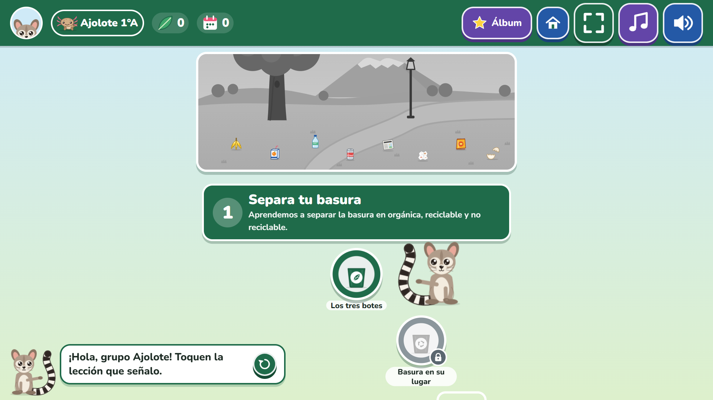

# Mixtle al rescate

Videojuego educativo para **Eco Urban A.C.** (Toluca, Estado de México), pensado para el programa *Escuelas Comprometidas con el Medio Ambiente*.

Mixtle, un cacomixtle que vive en los árboles del parque, guía a cada grupo de salón por un **camino de aprendizaje** con cinco unidades: separar la basura, los animales del parque, los árboles, el aire limpio y reducir y reutilizar. Cada lección dura unos 3 minutos y cada unidad termina con una **aventura**: un minijuego con escena.

- **Para quién:** niñas y niños de 1º a 3º de primaria (6 a 8 años). Mixtle narra todo en voz alta; el texto acompaña, pero no hace falta saber leer.
- **Dónde:** en la laptop de Eco Urban proyectada en el salón (todo el grupo participa) o en tablets táctiles.
- **Dónde jugarlo:** <https://mixtle-al-rescate.vercel.app> (producción en Vercel). La dirección anterior, <https://caco-al-rescate.vercel.app>, sigue funcionando: lleva a la nueva **con el avance de los grupos** (ver *Nombre y dirección anteriores*).
- **Qué es:** un prototipo jugable para revisar con el equipo educativo. No tiene servidor, cuentas ni analítica. El avance de cada grupo se guarda solo en el aparato.



## Qué cambió en la v2

| v1 | v2 |
|---|---|
| Una sola partida de 5 pantallas (Phaser) | **Camino de aprendizaje** con 5 unidades, 20 lecciones y 5 aventuras |
| Voz del navegador (distinta en cada equipo) | **Voz pregenerada** de Mixtle (Kokoro `em_alex`), igual en todos lados, más música CC0 con *ducking* |
| Nada se guardaba | **Grupos de salón** (animal mascota, color y etiqueta como "1°A"); el avance se guarda en el aparato |
| Solo arrastrar a los botes | **7 tipos de ejercicio** dirigidos por datos |
| Diploma al final | Hojitas, parque del grupo que crece, cofre, álbum de animales de Toluca, días jugados y **diploma por unidad** |
| Todo en Phaser | Interfaz en **React + Tailwind + Motion**; Phaser solo dentro de las aventuras (se descarga al entrar y se destruye al salir) |

La aventura de la unidad 1 son los tres niveles de la v1, adaptados al camino, y un bonus nuevo sin cámara: **"Lluvia de basura"**. **El juego ya no usa la cámara** en ninguna parte (se quitó a petición de Eco Urban): no pide permisos ni descarga modelos de visión.

## Cómo se juega

1. **Inicio → ¿Quién va a jugar?** Se elige el grupo o se crea uno: un animal (colibrí, ardilla, monarca, ajolote, tlacuache o cacomixtle), un color y, si se quiere, una etiqueta corta como "1°A". **Nunca se piden nombres de niñas ni niños**, y la pantalla lo recuerda.
2. **El camino.** Arriba está el **parque del grupo**: empieza gris y con basura, y se limpia y llena de árboles, flores y animales conforme el grupo avanza. Abajo, el camino en zigzag con las lecciones de cada unidad, un **cofre** a la mitad y la **aventura** al final. Mixtle se para junto a la siguiente lección y la señala. Las lecciones se abren en orden y las terminadas se pueden repetir.
3. **Una lección** (6 a 8 ejercicios, unos 3 minutos). Barra de avance arriba, botón para salir con confirmación amable, y Mixtle narra cada consigna.
   - **Bien:** banner verde, Mixtle feliz, un sonido y una frase de ánimo distinta cada vez.
   - **Casi:** banner naranja con una pista y "Intentar otra vez". No hay vidas ni castigos; lo que salió mal vuelve al final para repasar.
   - **Al terminar:** hojitas ganadas, cuántos ejercicios salieron a la primera, el parque creciendo y el jingle.
4. **Recompensas.** Hojitas por lección y por cofre; una **estampa del álbum** por cada unidad terminada (cacomixtle, mariposa monarca, colibrí, ajolote de montaña y tlacuache, cada una con un dato narrado), y los **días jugados**, sin culpa ni presión si un día no se juega.

| Lección: un error con pista | Lección terminada |
|---|---|
|  |  |
| **Aventura de la unidad 2** | **Diploma de unidad** |
|  |  |

### Las cinco unidades

| Unidad | Lecciones | Aventura | Estampa |
|---|---|---|---|
| 1. Separa tu basura | Los tres botes · Basura en su lugar · Una segunda vida · ¿Y si se revuelve? | **Limpia el parque**: los 3 niveles de la v1 y el bonus "Lluvia de basura" (cae una basura a la vez y se toca su bote; si llega al suelo, vuelve a caer) | Cacomixtle |
| 2. Los animales del parque | ¿Quién vive aquí? · La basura los lastima · Nada de comida chatarra · Vecinos de Toluca | **Rescate en el parque**: liberar animales atrapados en basura y separarla | Mariposa monarca |
| 3. Árboles y áreas verdes | ¿Para qué sirven? · Plantamos un árbol · Lo cuidamos · Casa de animales | **Siembra un bosquecito**: plantar seis arbolitos y regarlos hasta que crezcan (amplía el nivel 3 de la v1) | Colibrí |
| 4. Aire limpio | A pie o en bici · ¿Qué es el humo? · Días de contingencia · Cuidamos el aire | **En bici a la escuela**: cambiar de carril para esquivar el humo y juntar hojitas | Ajolote de montaña |
| 5. Reduce y reutiliza | Mi botella y mi lonchera · Menos desechables · Una segunda vida · Menos basura | **Mi lonchera sin basura**: cada cosa a la lonchera o a "Mejor no" | Tlacuache |

### Los 7 tipos de ejercicio

Todos funcionan con toque y con mouse, con zonas de toque de 64 px o más.

1. **Elige la imagen:** Mixtle pregunta y se toca una de 2 a 4 tarjetas.
2. **Al bote:** se arrastra cada residuo a su bote (o se toca el bote). Usa la lógica de la v1.
3. **Parejas:** se toca una tarjeta y luego su pareja (residuo y bote, animal y su comida, animal y su casa).
4. **¿Sí o no?:** una acción ilustrada y dos caritas propias (feliz y triste), que se distinguen por la boca y no solo por el color.
5. **Ordena los pasos:** se tocan 3 o 4 tarjetas en orden (cómo se planta un árbol).
6. **Encuentra el error:** una escena con 1 a 3 cosas mal (basura en el pasto, una llave goteando, basura quemándose).
7. **Escucha y toca:** Mixtle nombra algo y se toca su dibujo, sin texto. Es para quienes todavía no leen.

### Modo facilitador

Para la persona que facilita: **mantén presionado el logo de Mixtle (arriba a la izquierda) 3 segundos.** Ahí se puede reiniciar el avance del grupo, abrir todas las lecciones para saltar directo a una y activar el **modo proyector** (todo más grande).

## Nombre y dirección anteriores

Hasta la v2, el personaje se llamaba **Caco** y el juego, "Caco al rescate" (la versión que vio Eco Urban está en la etiqueta de git `v2-eco-urban`). Desde la v3 se llama **Mixtle**, y el juego, **"Mixtle al rescate"**, con el lema **"Guardianes del parque"**. La palabra "cacomixtle" se queda donde nombra al animal.

- **Dirección:** el juego está en <https://mixtle-al-rescate.vercel.app>. Si se abre la dirección anterior, <https://caco-al-rescate.vercel.app>, el juego empaca los grupos y las preferencias de ese navegador, borra su copia sin conexión y abre la dirección nueva con todo eso en el fragmento de la URL (`#mudanza=…`, que nunca se envía a ningún servidor). En la dirección nueva, los grupos se juntan con los que ya hubiera, sin perder ninguno. Lo hace `src/servicios/mudanza.ts` y `mudarse.ts`.
- **Datos guardados con el nombre anterior** (IndexedDB `caco-al-rescate` y las claves `caco-al-rescate:*` de `localStorage`) pasan solos a `mixtle-al-rescate` al abrir el juego (`src/servicios/migracion.ts`, con pruebas en `tests/migracion.test.ts`).
- **Repositorio:** `renecano/mixtle-al-rescate` (GitHub redirige el nombre anterior).
- **Carpeta local:** se sigue llamando `caco_al_rescate` en la laptop donde se desarrolló; no se renombró porque se estaba trabajando en ella. No afecta en nada al juego.

## Direcciones visuales de la v3

`docs/direccion-visual/index.html` muestra tres direcciones para la v3 (A · Parque de día, B · ¡Al rescate!, C · Fiesta del Nevado): logo con Mixtle, inicio, lección, recompensa, paleta, tipografía y contraste WCAG medido en la misma página. Usa el arte real del juego (`npm run docs:direccion` lo exporta de `src/arte/`). **Elegida: A · Parque de día** (28 de octubre de 2026). La guía de marca está en [`docs/marca.md`](docs/marca.md).

## Correrlo en Windows

Requisitos: [Node.js](https://nodejs.org) 22.12 o más nuevo (la versión LTS sirve) y Chrome o Edge.

```powershell
npm install
npm run dev
```

Abre <http://localhost:5173> en Chrome o Edge. Para proyectar, usa el botón de pantalla completa del juego (o F11).

Todos los comandos son scripts de npm; ninguno necesita bash. Funcionan en PowerShell o en el símbolo del sistema.

| Comando | Qué hace |
|---|---|
| `npm run dev` | Juego en modo desarrollo, con recarga automática |
| `npm run build` | Genera el sitio estático en `dist/` (con su *service worker* para jugar sin internet) |
| `npm run preview` | Sirve `dist/` para probar la versión final |
| `npm test` | Pruebas unitarias (Vitest) |
| `npm run test:e2e` | Recorridos completos en el navegador (Playwright) |
| `npm run verificar` | Tipos + lint + pruebas + build, todo junto |
| `npm run voz:generar` / `voz:lista` | Voces de Mixtle y lista de frases para grabar (ver abajo) |
| `npm run capturas` | Regenera las capturas de `docs/capturas/` jugando un recorrido (con `npm run preview` abierto) |

Atajos para revisar (solo en desarrollo o con `?e2e` en la dirección): `?galeria` muestra todo el arte; `?escena=Rescate&unidad=u2` entra directo a una aventura (`Bosque`/`u3`, `Bici`/`u4`, `Lonchera`/`u5`, o una escena de la v1 como `Nivel2`).

## Desplegar en Vercel

El proyecto es un sitio estático y ya incluye `vercel.json` (Vite, `npm run build`, carpeta `dist`, cabeceras de seguridad y caché; el *service worker* nunca se guarda en caché para que las actualizaciones lleguen).

**Hoy:** el repositorio es privado en GitHub (`renecano/mixtle-al-rescate`) y el proyecto de Vercel `mixtle-al-rescate` está conectado a él: **cada *push* a `main` se publica solo en producción** (<https://mixtle-al-rescate.vercel.app>). El primer despliegue automático falló porque `vercel.json` tenía un patrón de cabeceras que Vercel no acepta; ya está corregido (una regla por archivo del *service worker*).

**Con GitHub (recomendado):** en [vercel.com](https://vercel.com), *Add New → Project* e importa el repositorio. Cada rama o *pull request* genera una **versión de prueba** (*preview*) con su propia dirección; lo que llega a `main` se publica en **producción**. Así Eco Urban puede revisar cambios antes de que lleguen a los salones.

**Desde la terminal:**

```powershell
npx vercel          # versión de prueba
npx vercel --prod   # producción
```

**Integración continua:** `.github/workflows/ci.yml` corre en cada *push* y *pull request*. Revisa tipos, lint, pruebas y build en Ubuntu **y en Windows**, y después los recorridos en el navegador.

## Editar el contenido

Todo el contenido vive en archivos de datos, separado de la lógica, para que el equipo educativo lo revise y lo cambie. Cada archivo está marcado con `TODO(Eco Urban)`.

- **`src/contenido/unidades/u1-separa.ts` … `u5-reutiliza.ts`:** una unidad por archivo, con su título, tema, color, cofre, estampa (con su dato), aventura y lecciones. Cada lección es una lista de ejercicios; cada ejercicio tiene `tipo`, `consigna`, `pista` y sus datos. Los tipos están documentados en `src/contenido/tipos.ts`. Los dibujos se nombran por su clave; para verlos todos, abre `?galeria`.
- **`src/contenido/aventuras.ts`:** lo que dice Mixtle en las aventuras 2 a 5 y en su diploma.
- **`src/contenido/textosApp.ts`:** lo que dice Mixtle en las pantallas (grupos, camino, cofre, lección, álbum).
- **`src/data/residuos.ts` y `src/data/categorias.ts`:** los residuos y los botes, configurables como en la v1 (de 2 a 4 botes cambiando solo `categorias.ts`; los ejemplos están al final del archivo).

Las pruebas revisan que el contenido sea válido: 4 o 5 lecciones por unidad, de 6 a 8 ejercicios con al menos 3 tipos distintos, respuestas correctas que existen, dibujos que existen, ningún ejercicio imposible y todos los residuos con exactamente un bote.

**Datos verdaderos.** Cada dato que dice Mixtle tiene su fuente en [`docs/fuentes-contenido.md`](docs/fuentes-contenido.md) (CONABIO, CONANP, SEMARNAT, CONAFOR, UNAM, OMS, EPA, entre otras). Ahí también está lo que **no** se usa por no tener fuente confiable (por ejemplo, "un popote tarda 500 años en degradarse"). Si se agrega un dato, hay que anotar su fuente.

Después de cambiar cualquier texto, corre `npm run voz:generar` para que Mixtle lo diga con su voz.

## Voz de Mixtle y música

### Cómo se generan las voces

Mixtle habla con audios **pregenerados** que están en el repositorio (`public/voz/`). El juego solo los reproduce: no sintetiza voz en el navegador ni usa servicios de pago. La voz es **Kokoro `em_alex`** en español latinoamericano, elegida entre las muestras de `docs/muestras-voz/`.

Para regenerarlas, en PowerShell:

```powershell
npm run voz:preparar   # solo la primera vez: crea .venv-voz (Python 3.10–3.12) y descarga los modelos (~250 MB)
npm run voz:generar    # genera solo las frases nuevas o cambiadas
```

- **Qué necesita.** `voz:preparar` busca un Python 3.10–3.12; si no lo encuentra, dice cuál instalar. ffmpeg y espeak-ng vienen dentro de los paquetes de Python.
- **Qué hace `voz:generar`:**
  - junta automáticamente todo lo que dice Mixtle desde los archivos de contenido (`src/voz/frases.ts`), incluidas las unidades, las lecciones y las aventuras;
  - aplica `voz.config.json` (proveedor, voz, velocidad y diccionario de pronunciación);
  - guarda `public/voz/<hash-del-texto>.mp3` (mono, 64 kbps, volumen normalizado) y `public/voz/manifiesto.json`;
  - solo regenera las frases cuyo texto o configuración cambiaron, y borra los audios que ya no se usan.
- **Pronunciación.** El diccionario de `voz.config.json` cambia cómo se lee una palabra solo en el audio ("Mixtle" → "Míkstle" y "cacomixtle" → "cacomíkstle": las dos con "ks", como en "mix"). El texto en pantalla no cambia.
- **Números.** Las frases con números que de verdad pueden salir (el resumen de cada lección para cada resultado, el cofre y los diplomas) se graban **completas**, para que Mixtle las diga de corrido: encadenar piezas sonaba entrecortado. Como respaldo, para cualquier otro número se pregeneran del 0 al 100 (con "un" y "veintiún" antes de sustantivo) y se encadenan, cargando todas las piezas antes de empezar a hablar. La lista está en `narracionesCompletas()` de `src/voz/frases.ts`.
- **Respaldo.** Si una frase no tiene audio, el juego usa la voz del navegador y, en desarrollo, lo avisa en la consola. Una prueba unitaria revisa que **toda** frase narrada tenga su audio en el manifiesto.
- **En una máquina lenta** se puede generar por partes: `npm run voz:generar -- --max=50`. Cada corrida sigue donde se quedó la anterior.

### Voz con Azure AI Speech

La v3 deja listo **Azure AI Speech** como proveedor (`scripts/voz/azure.mjs`: API REST con `fetch` y SSML, sin SDK). Kokoro sigue como alterno, y las grabaciones humanas siguen teniendo prioridad sobre las dos.

- **La llave.** En `.env.local` (ya está en `.gitignore`), **sin** el prefijo `VITE_`, para que Vite nunca la mande al navegador:

  ```
  AZURE_SPEECH_KEY=…
  AZURE_SPEECH_REGION=southcentralus
  ```

  La llave solo se usa al **generar** los audios en la computadora de quien prepara el juego. El juego publicado sigue reproduciendo mp3 pregenerados y nunca llama a Azure. `tests/llave.test.ts` revisa que `.env.local` esté ignorado, que el código del juego no lea la llave y que ni el repositorio ni `dist/` contengan su valor (se comprobó plantando una llave falsa en `dist/`: la prueba falla).
- **Elegir la voz.** `npm run voz:muestras -- --proveedor=azure` consulta las voces es-MX y es-US de la región y genera las mismas frases (saludo, acierto, pista amable, dato curioso) con cada una: normal, con estilo alegre si la voz lo tiene, tono +5 % y +10 % y un poco más lenta, más cómo dice "Mixtle" y "cacomixtle". La página `docs/muestras-voz/azure.html` incluye la voz actual (Kokoro) para comparar y se puede mandar a Eco Urban. Gasta como máximo ~20,000 caracteres.
- **Cambiar la voz.** `npm run voz:usar -- azure` (o `kokoro`) cambia el proveedor activo; la voz y los ajustes de cada uno (`voz`, `idioma`, `estilo`, `tono`, `velocidad`) están en `voz.config.json`. Después, `npm run voz:generar`. La firma de cada audio incluye proveedor, voz, estilo, ajustes y texto, así que un cambio regenera lo necesario y nada más.
- **Costo.** El plan gratuito (F0) da 500,000 caracteres al mes. Todas las frases del juego suman 36,984 (medido con las 740 frases de la v3): regenerar todo cabe más de 10 veces al mes. Antes de cada corrida se cuentan los caracteres y el uso del mes se lleva en `.voz-uso.json` (local, ignorado por git); si el mes pasaría de **400,000**, se detiene, salvo con `--forzar`. Entre peticiones espera ~3 s y reintenta los 429 con espera creciente.
- **Pruebas.** `tests/azure.test.ts` corre todo contra un servidor falso (SSML, lista de voces, reintento de 429, presupuesto, página de muestras). También se probó `voz:generar` completo contra un servidor falso: SSML con estilo y tono, reintento, normalización y registro de uso.

### Grabar una voz humana

1. Corre `npm run voz:lista`. Genera `docs/frases-mixtle.csv` con columnas `id`, `archivo`, `texto`, `unidad` y `lección`; se abre bien en Excel.
2. Graba cada frase (por ejemplo, una persona de Eco Urban, o con Canva) y guarda el audio en `voz-grabaciones/` con el **mismo nombre de archivo** de la columna `archivo` (mp3, wav, m4a u ogg).
3. Corre `npm run voz:generar`. Las grabaciones reemplazan a la voz generada: se normalizan al mismo volumen y quedan marcadas como humanas en el manifiesto. Las frases sin grabar conservan la voz generada.

### Cambiar la música

Las tres pistas (tranquila, lecciones y celebración) son CC0 y están en `public/musica/`. Para cambiar una:

1. Agrega la candidata a `scripts/musica/candidatas.json` (solo CC0, con su página) y corre `npm run musica:muestras` para escucharla junto a las demás.
2. Pon su `id` en `scripts/musica/elegidas.json` y corre `npm run musica:instalar`.
3. Anótala en `CREDITOS.md`.

En el juego la música va baja (≈25 %), baja a ≈8 % mientras habla Mixtle y sube suave al terminar. Entre pistas hay un fundido, y solo empieza después del primer toque. Música y voz tienen botones separados, y cada uno se recuerda en el aparato.

Los efectos de sonido se generan con `npm run sonidos:generar`.

## Privacidad y datos

- **No se guarda nada de las niñas y los niños.** Los grupos se identifican con un animal, un color y una etiqueta corta; la pantalla pide no escribir nombres, y la etiqueta acepta solo 8 caracteres.
- El avance de cada grupo se guarda **solo en este aparato** (IndexedDB). No viaja a ningún servidor. Si el navegador bloquea el almacenamiento, el juego funciona igual y el avance dura mientras la página esté abierta.
- Las preferencias de voz, música y modo proyector se guardan en `localStorage`, siempre dentro de `try/catch`.
- **No se usa la cámara ni el micrófono.** `vercel.json` los bloquea con `Permissions-Policy: camera=(), microphone=()`.
- El juego **solo hace descargas** (peticiones GET). Las pruebas de recorrido verifican que no haya ninguna petición que envíe datos.

## Pruebas y evidencia medida

**Pruebas unitarias (Vitest)**, en `tests/`: **1247 pruebas en 20 archivos, todas pasan.** Entre ellas:

- **Contenido válido:** cada unidad tiene 4 o 5 lecciones; cada lección tiene de 6 a 8 ejercicios con al menos 3 tipos; las respuestas correctas existen, los dibujos existen, no hay ejercicios imposibles (parejas sin repetir, "encuentra el error" con 1 a 3 errores dentro de la escena). Cuando una pregunta habla de un bote, dice su color **y su nombre** ("el bote naranja de no reciclable") y el bote se ve en pantalla. Cada archivo de contenido está marcado con `TODO(Eco Urban)`.
- **Voz:** **toda frase narrada (740) tiene su audio en el manifiesto** y su mp3 existe, y **los 169 resúmenes con números** (fin de lección, cofre, diplomas) suenan como **un solo audio**, sin piezas encadenadas.
- **Camino y grupos:** las lecciones se desbloquean en orden; el cofre y la aventura se abren a su tiempo; el avance de cada grupo se guarda y se recupera por separado, y **la app no falla si IndexedDB está bloqueado**.
- **Música:** el *ducking* baja la música mientras habla Mixtle y la sube al terminar (también si dos cosas la agachan a la vez); fundido entre pistas, jingle y nada antes del primer toque.
- **Aventuras y diploma:** el recorrido en bici nunca pone humo en los dos carriles a la vez; la lonchera tiene cosas de los dos tipos, sin patrón para adivinar; la concordancia de los números ("1 animal", "2 animales").
- Las de la v1 siguen: cada residuo va a exactamente un bote (con 2, 3 o 4 botes), pistas amables que nombran el color, el nombre y el dibujo de cada bote, y contraste AA.

**Recorridos en el navegador (Playwright)**, en `e2e/`, a **1920×1080 (proyector)** y **1024×768 (tablet táctil)**:

- Crear un grupo, completar una lección **con un error**, ver la pantalla final, ver **crecer el parque**, recargar y encontrar el avance guardado, y abrir el álbum.
- Jugar las **cinco aventuras** de principio a fin (la de la unidad 1, con el facilitador y la estampa ganada).
- Cada botón mide **al menos 64 px reales** en el camino, la lección y el inicio.
- **Ninguna petición envía datos** (solo GET) y no hay errores en la consola.

Para correrlos contra un sitio ya publicado, sin construir nada en local: `$env:BASE_URL="https://…"; npm run test:e2e`. En una laptop de 8 GB usan **un solo navegador a la vez**; con varios, la memoria se agotó y el sistema cerró las pruebas.

**Última corrida contra producción** (27 de octubre de 2026, en la dirección de entonces, caco-al-rescate.vercel.app, un navegador a la vez, 34.6 min): **22 de 26 pasan.** Las 4 que fallan, sin corregir todavía:

| Prueba | Tamaño | Qué pasó |
|---|---|---|
| Aventura 1 completa: la lluvia de basura | 1920×1080 | Cuando la basura llega al suelo, mientras Mixtle dice "¡Uy, llegó al suelo!…", **los botes no responden**; la prueba tocó el bote en ese momento y el toque se perdió. En la tablet sí pasó. Un niño que toque en ese par de segundos tampoco obtiene respuesta. |
| El botón de sonido se recuerda y el juego no se rompe sin `localStorage` | 1920×1080 y 1024×768 | **La prueba está desactualizada:** después de "¡Jugar!" espera la intro de la v1, pero en la v2 aparece "¿Quién va a jugar?". Todo lo anterior pasó: la preferencia se recuerda y el juego arranca con el almacenamiento bloqueado. |
| Cada botón mide al menos 64 px (camino) | 1024×768 | La prueba se quedó esperando a un botón que ya no estaba en pantalla (el globo de Mixtle se oculta al terminar de hablar) hasta agotar los 8 min. La captura muestra el camino bien. Es un problema de la prueba; en la corrida anterior pasó. |

**Mediciones** (27 de octubre de 2026, build de producción):

| Qué | Resultado |
|---|---|
| Lo que se descarga al abrir el juego | **≈ 158 KB** comprimidos (React 44 KB + app 107 KB + estilos 7 KB) y 48 KB de la fuente Nunito |
| Phaser (solo al entrar a una aventura) | ≈ 310 KB comprimidos, más 2 a 7 KB por aventura |

| Voces de Mixtle | 740 frases, **17.4 MB** en total (mono, 64 kbps), incluidas 169 frases con números grabadas completas |
| Música y efectos | 1.3 MB (3 pistas) y 78 KB (12 efectos) |
| Juego sin internet (PWA) | En la primera visita, el *service worker* descarga en segundo plano 783 archivos (**20.6 MB**: juego, voces, música y efectos); después se juega sin internet |

**En el sitio publicado** (27 de octubre de 2026, en la dirección de entonces, caco-al-rescate.vercel.app, Chrome en Windows 11, conexión doméstica):

| Qué | Resultado |
|---|---|
| Pantalla de inicio lista (primera visita, sin caché) | **0.61 s**, 170 KB transferidos |
| Voz y música | Mixtle habla con su voz grabada (0 frases con la voz del navegador) y suena la música de fondo |
| El *service worker* termina de guardar el juego | 675 archivos en **79 s** (medido antes de agregar las 169 frases completas; en segundo plano, se puede jugar mientras tanto) |
| Sin internet, después de eso | El juego abre, Mixtle habla y suena la música |

## Limitaciones conocidas

- **El contenido lo debe revisar el equipo educativo de Eco Urban.** Todo está marcado con `TODO(Eco Urban)`. Los datos tienen fuente verificada (`docs/fuentes-contenido.md`), pero la redacción para cada grado, las categorías de separación de Toluca y la ley citada sobre quemar basura (artículo por confirmar en el PDF oficial) necesitan su visto bueno.
- **No se ha probado con niñas y niños** ni en un iPad real con Safari. Se probó con Chrome en Windows (también con emulación táctil a 1024×768). Esa prueba de uso es el siguiente paso recomendado.
- **El avance vive en un solo aparato.** Si se borran los datos del navegador o se cambia de laptop, el grupo empieza de nuevo. Es a propósito (no hay servidor ni cuentas), pero hay que saberlo.
- **La voz es sintética.** Kokoro suena natural, pero algunas palabras pueden sonar raras. El diccionario de pronunciación y la grabación humana (ver arriba) son la forma de corregirlas sin tocar código.
- **Versiones nuevas:** al publicar una versión, el *service worker* la descarga en segundo plano. En cuanto toma el control, Mixtle usa la lista de audios nueva y la página se recarga sola al volver a la pantalla de inicio (nunca a media lección). La lista de audios siempre se pide primero a internet, para que una versión vieja guardada no deje a Mixtle con audios viejos.
- **La primera visita necesita internet:** el *service worker* descarga unos 21 MB (sobre todo las voces) para que después funcione sin conexión. Conviene abrir el juego una vez con buena señal antes del taller.

- **Las aventuras son minijuegos cortos** (2 a 4 minutos). Las del bosquecito y la lonchera siempre tienen el mismo número de cosas: los diplomas muestran el esfuerzo, no un puntaje para comparar grupos.
- El diploma de la unidad 1 cuenta los residuos separados en el nivel 2 y en la lluvia de basura (12 + 5) y los animales ayudados.

## Estructura

```
src/
  app/         interfaz en React: pantallas (inicio, grupos, camino, lección, álbum, aventura),
               componentes, ejercicios (los 7 tipos) y estado (Zustand)
  contenido/   lo que se enseña: unidades y lecciones, textos de la app y de las aventuras
  aventuras/   una entrada por unidad; monta Phaser solo al entrar a la aventura
  scenes/      escenas de Phaser: niveles de la v1, Rescate, Bosque, Bici, Lonchera y el diploma
  logica/      reglas puras y probadas: lección, camino, grupos, clasificación, diploma
  servicios/   voz, música y efectos, almacenamiento (IndexedDB)
  voz/         frases narradas, hash de audios y encadenado de piezas
  arte/        ilustraciones originales en SVG (como código)
  ui/          piezas de Phaser: Mixtle, botones, globo, botes, animales, clasificador
tests/         pruebas unitarias (Vitest)
e2e/           recorridos en el navegador (Playwright)
scripts/       voces, música, efectos, íconos y capturas
docs/          fuentes del contenido, lista de frases, capturas y muestras
```

## Créditos y licencias

El arte es original de este proyecto: ilustraciones SVG hechas en código. Los efectos de sonido se sintetizan con scripts propios, la voz se genera con Kokoro (Apache-2.0) y la música es CC0. La tipografía es Nunito (OFL-1.1). Las bibliotecas son React, Phaser, Motion, Zustand y Howler (MIT), idb-keyval (Apache-2.0). El detalle completo está en [`CREDITOS.md`](CREDITOS.md).
