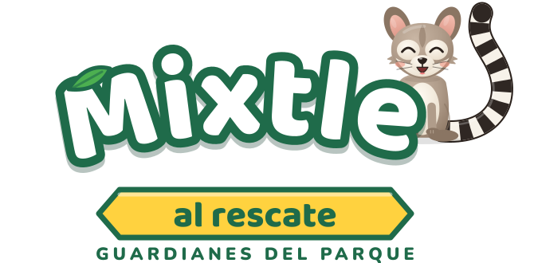
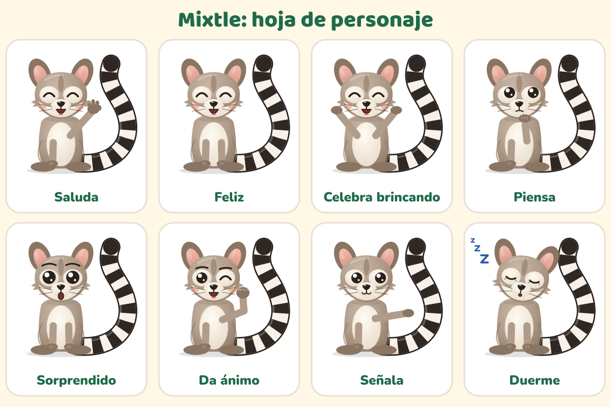

# Marca de "Mixtle al rescate"

Mini guía para quien haga materiales del juego (Eco Urban, maestras y maestros, diseño). Dirección visual elegida: **A · Parque de día**.

## Logo

- **Archivos:** `public/marca/logo.svg` (y la copia `docs/marca/logo.svg`). Es SVG puro: las letras están convertidas en trazos, así que se ve igual en cualquier computadora, aunque no tenga las fuentes.
- **Partes:** "Mixtle" en arco (blanco con borde verde y una sombra suave), Mixtle sentado al final de la palabra, el listón amarillo "al rescate" y el lema **"Guardianes del parque"**.
- **Sin Mixtle:** cuando Mixtle ya está en la escena (por ejemplo, en el inicio), se usa la versión sin él (`logoSvg({ sinMixtle: true })`), para no tener dos Mixtle.
- **Espacio libre:** alrededor del logo, al menos la altura del listón. Tamaño mínimo: 240 px de ancho en pantalla, 5 cm impreso.
- **Ícono de la app:** la cabeza de Mixtle sobre un círculo de cielo con fondo verde (`public/favicon.svg` y `public/iconos/`). La versión "maskable" deja la cara dentro de la zona segura de Android.
- **Cómo se regenera:** `npm run marca:generar` vuelve a hacer las letras en trazos, el logo, el favicon, los íconos PNG y la hoja de personaje. Una prueba (`tests/marca.test.ts`) avisa si quedaron desfasados.

**No:** cambiar los colores del logo, estirarlo, ponerle contorno o sombra extra, girarlo, ponerlo sobre fondos oscuros u ocupados sin su recuadro claro, o escribir "Mixtle" con otra letra en su lugar.

## Colores

| Nombre | Hex | Uso |
|---|---|---|
| Verde bosque | `#1F6B4A` | Marca, bordes del logo, botones de sistema |
| Verde noche | `#123D2B` | Sombras y textos sobre claro |
| Sol | `#FFD23F` | Acentos, listón, racha, estampas |
| Naranja barro | `#B84A14` | Botón principal ("¡Jugar!", "¡Sigamos!") |
| Cielo | `#D3EEF9` | Fondos |
| Crema | `#FFF8E7` | Tarjetas y papel |
| Hoja | `#4CAF50` | Hojitas y detalles de naturaleza |

Contraste medido (WCAG 2.x): blanco sobre naranja barro 5.21:1, verde bosque sobre blanco 6.44:1, tinta `#1D2B24` sobre sol 10.22:1, blanco sobre verde bosque 6.44:1. Todos pasan AA. Cada unidad tiene además su color propio en el camino (todos con contraste AA para texto blanco).

## Tipografía

- **Baloo 2 ExtraBold** para títulos y botones grandes (OFL 1.1).
- **Nunito** 700, 800 y 900 para todo lo demás (OFL 1.1).
- Las dos vienen dentro de la app (`@fontsource`), así que el juego funciona sin internet. En materiales impresos se pueden descargar de Google Fonts.

## Mixtle

**Quién es.** Mixtle es un cacomixtle joven que vive en un parque de Toluca. Los cacomixtles son animales reales del centro de México: esbeltos, de orejas grandes, con anillos claros alrededor de los ojos y una cola larga con anillos blancos y negros. Mixtle es un personaje original de este proyecto, dibujado a partir del animal real, sin parecido con personajes con derechos de autor.

**Personalidad.** Curioso, valiente y un poco despistado. Le encanta trepar árboles. Como buen cacomixtle, de noche anda despierto, y a veces se le ve dormido de día. Nunca presume: el héroe es el grupo, y él lo acompaña. Celebra el esfuerzo, no solo el acierto.

**Su frase:** **"¡Al rescate!"**. La dice al empezar a jugar y en los momentos de premio.

**Las 8 poses** (claves de arte `mixtle-<pose>`):

| Pose | Cuándo se usa |
|---|---|
| Saluda (`saluda`) | Bienvenidas, al entrar al camino |
| Feliz (`feliz`) | Después de un acierto, en el logo |
| Celebra brincando (`celebrando`) | Fin de lección, cofre, estampa nueva |
| Piensa (`pensando`) | Pistas ("¡Casi!"), lecciones bloqueadas |
| Sorprendido (`sorprendido`) | Un cofre nuevo, preguntar si salir |
| Da ánimo (`animo`) | "¡Vamos!": a la mitad de la lección, al reintentar |
| Señala (`senalando`) | Indicar la siguiente parada o la consigna |
| Duerme (`duerme`) | Modo vitrina en pausa y pantallas de espera |

**En reposo** Mixtle nunca está congelado: parpadea, mueve las orejas de vez en cuando y su cola se mece. Con "animaciones suaves" (modo facilitador) o con el movimiento reducido del sistema, deja de mover las orejas y se calma la cola.

## Tono de Mixtle

- Habla al grupo, de "ustedes": "¡Lo lograron!", "Toquen la lección que señalo".
- Frases cortas, de una idea, en español de México, que se entienden al oírlas (las niñas y los niños de 6 años todavía no leen con soltura).
- Ante un error dice **"¡Casi!"** y da una pista. Nunca "mal", "incorrecto" ni nada que regañe.
- Celebra el esfuerzo ("¡Practicando, cada vez les sale mejor!") y nunca compara grupos.
- Nada de presión: no hay prisa, ni cuentas regresivas, ni "si no juegas pierdes".
